# `common`

The OS baseline every VM gets, first in `just deploy --only configure`: packages, the login user with its sudo rule and SSH keys, sshd hardening, the timezone and the guest agent. `--tags common` runs it alone.

What those defaults mean for the VM: [What the VM trusts](../../guides/what-the-vm-trusts.md). How it works: [§5.3](../../architecture/roles.md#53-common--os-baseline).

<!-- BEGIN_GENERATED: role -->
<!-- Generated by `just docs` from roles/common/meta/argument_specs.yml, vars/main.yml and tasks/: edit that, not this section. -->

## Entry point `main`

**OS baseline for a development VM**

| Variable | Type | Default | Description |
|---|---|---|---|
| `common_user` | str | `dev` | Login user, normally created by cloud-init, that the role gives its shell, groups, sudo rule and keys. Set through `vm_user` in local.yml. |
| `common_user_shell` | str | `/bin/bash` | Login shell of common_user. |
| `common_user_groups` | list of `str` | `[sudo]` | Groups common_user is added to. Groups it already has are kept. |
| `common_user_passwordless_sudo` | bool | `true` | Let common_user run sudo without a password, through a sudoers drop-in, which the playbooks' become relies on. false makes sudo ask for common_user_password, which the playbooks then become root with, and needs it set. It removes the role's drop-in and cloud-init's own rule for the user (90-cloud-init-users), keeps a new cloud-init instance from writing that rule again (cloud.cfg.d), takes the user out of common_user_groups_revoked, and fails if sudo still lets the user run anything without a password. |
| `common_user_password` | str | `""` | The password sudo asks common_user for when common_user_passwordless_sudo is false, set by the role. A secret: never logged. Set through `vault_vm_password` in vault.yml. |
| `common_user_groups_revoked` | list of `str` | `[adm, cdrom, lxd]` | Groups common_user is taken out of when common_user_passwordless_sudo is false, unless common_user_groups lists one. cloud-init gives the user it creates all three. lxd gets LXD from Ubuntu's lxd-installer on first use, root wherever snapd runs; cdrom reads the cloud-init drive, which holds the password's hash; adm reads every system log. |
| `common_user_ssh_public_keys` | list of `str` | `[]` | Public keys added to common_user's authorized_keys. Keys already there are kept. Set through `vm_ssh_public_keys` in local.yml. |
| `common_timezone` | str | `Etc/UTC` | Timezone name from /usr/share/zoneinfo, such as Europe/Berlin, linked to /etc/localtime. |
| `common_manage_hostname` | bool | `true` | Set the hostname to common_hostname. Never done in a container (common_container_virt_types). |
| `common_hostname` | str | same as `inventory_hostname` | Hostname given to the VM. Defaults to the inventory hostname, the VM's name. |
| `common_harden_ssh` | bool | `true` | Write an sshd drop-in that turns password logins off, root's included, even where cloud-init was given a password. false removes it. |
| `common_ssh_path_dirs` | list of `str` | `[.local/bin, .cargo/bin]` | Directories in common_user's home put first on PATH for every session sshd starts for that user, `ssh vm <command>` included, which reads no profile. Written as an sshd drop-in (Match User, SetEnv) holding the whole PATH, the rest being /etc/environment's, and checked with sshd -T. Login shells get ~/.local/bin from /etc/profile.d, and ~/.cargo/bin there too where dev_tools installs Rust. [] removes the drop-in. |
| `common_tmux_settings` | list of `str` | `[set -g allow-passthrough on, set -g focus-events on, set -s extended-keys on, 'set -as terminal-features ''xterm*:extkeys''']` | tmux commands written as one block of /etc/tmux.conf, which tmux reads before ~/.tmux.conf, so a setting of the user's own wins; lines of the file outside the block are left as they are. The default is what Claude Code's terminal documentation asks for inside tmux - notifications and the progress bar passed through to the outer terminal, Shift+Enter told from Enter. allow-passthrough lets a program in a pane write escape sequences to the terminal you attach from, as it could without tmux. [] takes the block out. |
| `common_apt_upgrade` | bool | `true` | Upgrade the installed packages (apt safe upgrade) on every run. |
| `common_apt_cache_valid_time` | int | `3600` | Seconds the apt cache counts as fresh. An older one is refreshed at the start of the role. |
| `common_apt_lock_timeout` | int | `600` | Seconds each apt task waits for the apt lock, which unattended-upgrades holds on a fresh cloud image after first boot. |
| `common_apt_keep_downloads` | bool | `false` | false deletes each package apt downloads once it is installed, empties apt's download cache daily, and empties it once of what was left there. true keeps them, as apt-get does by default. |
| `common_container_virt_types` | list of `str` | `[docker, container, containerd, podman, lxc]` | Virtualisation types under which the hostname is not set, because the host is a container. |
| `common_packages` | list of `str` | `[apt-transport-https, bash-completion, build-essential, ca-certificates, curl, fd-find, git, gnupg, htop, jq, less, openssh-server, python3, python3-pip, python3-debian, python3-venv, qemu-guest-agent, ripgrep, rsync, tmux, tree, unzip, vim, wget, zip, zstd]` | Baseline packages every VM gets. Setting it replaces the baseline; add packages with common_extra_packages instead. |
| `common_extra_packages` | list of `str` | `[]` | More packages to install on top of common_packages. Set through `vm_extra_packages` in local.yml. |
| `common_enabled_services` | list of `str` | `[qemu-guest-agent]` | Services enabled at boot and started, where systemd runs. qemu-guest-agent is started only where the VM has its port, /dev/virtio-ports/org.qemu.guest_agent.0, which Proxmox adds while the VM's agent is enabled. |
| `common_masked_units` | list of `str` | `[fwupd.service, fwupd-refresh.timer, multipathd.service, multipathd.socket, ModemManager.service, udisks2.service, snapd.service, snapd.socket, snapd.seeded.service]` | Units masked and stopped where systemd runs, of those the VM has; snapd's only while no snap is installed. [] masks none, and a unit taken off the list stays masked. |

## Entry point `image`

**What a golden template carries of the OS baseline - apt, packages, timezone, the user, sshd hardening, PATH, tmux and services**

Also takes, as described under `main`: `common_user`, `common_user_shell`, `common_user_groups`, `common_timezone`, `common_harden_ssh`, `common_ssh_path_dirs`, `common_tmux_settings`, `common_apt_upgrade`, `common_apt_cache_valid_time`, `common_apt_lock_timeout`, `common_apt_keep_downloads`, `common_packages`, `common_extra_packages`, `common_enabled_services`.

## Entry point `image_options`

**Record the options the image entry point is built with, for a golden template's key**

Also takes, as described under `main`: `common_user`, `common_user_shell`, `common_user_groups`, `common_timezone`, `common_harden_ssh`, `common_ssh_path_dirs`, `common_tmux_settings`, `common_apt_upgrade`, `common_apt_cache_valid_time`, `common_apt_lock_timeout`, `common_apt_keep_downloads`, `common_packages`, `common_extra_packages`, `common_enabled_services`.

## Internal values

Set in `roles/common/vars/main.yml`. These are not settings: Ansible ranks a role's vars above `local.yml`, so a value set there has no effect. 2 of the 9 are computed during a run, from earlier tasks' results. Each one's purpose is the first sentence of the comment above it, where it has one of its own.

| Name | Purpose | Value |
|---|---|---|
| `common_guest_agent_port` | Where a VM's guest-agent port appears. | `/dev/virtio-ports/org.qemu.guest_agent.0` |
| `common_ssh_path_system` | The rest of the PATH sshd gives common_user's sessions, after common_ssh_path_dirs: the one /etc/environment sets, as it is now, which PAM gives every other session. | <code>{{ common_environment.content &#124; default('') &#124; b64decode &#124; regex_findall('^PATH="?([^"\n]*)"?[ \t]*$', multiline=True) &#124; first &#124; default('', true) or '/usr/local/sbin:/usr/local/bin:/usr/sbin:/usr/bin:/sbin:/bin:/usr/games:/usr/local/games:/snap/bin' }}</code> |
| `common_ssh_path` | The PATH the drop-in gives common_user's ssh sessions, and the drop-in: whole, since SetEnv takes no variables. | <code>{{ (common_ssh_path_dirs &#124; map('regex_replace', '^', ansible_facts.getent_passwd[common_user][4] ~ '/') &#124; list + [common_ssh_path_system]) &#124; join(':') }}</code> |
| `common_ssh_path_dropin` |  | `/etc/ssh/sshd_config.d/15-agent-warehouse-path.conf` |
| `common_cloud_init_user_cfg` | With common_user_passwordless_sudo off: cloud-init's settings for the user it creates, read after cloud.cfg and every drop-in sorted before it. | `/etc/cloud/cloud.cfg.d/99-agent-warehouse-user.cfg` |
| `common_sshd_hardening` | The sshd hardening and apt's setting, by path. | `/etc/ssh/sshd_config.d/10-agent-warehouse.conf` |
| `common_apt_downloads` |  | `/etc/apt/apt.conf.d/90agent-warehouse-downloads` |
| `common_names_1x` | Each file by its name through 1.x and its name from 2.0, which names.yml moves it to (2.x), and the tmux block's 1.x marker, which tmux.yml takes out. | `[{"old": "/etc/ssh/sshd_config.d/10-claude-on-proxmox.conf", "new": "{{ common_sshd_hardening }}"}, {"old": "/etc/ssh/sshd_config.d/15-claude-on-proxmox-path.conf", "new": "{{ common_ssh_path_dropin }}"}, {"old": "/etc/apt/apt.conf.d/90claude-on-proxmox-downloads", "new": "{{ common_apt_downloads }}"}, {"old": "/etc/cloud/cloud.cfg.d/99-claude-on-proxmox-user.cfg", "new": "{{ common_cloud_init_user_cfg }}"}]` |
| `common_tmux_marker_1x` |  | `# {mark} claude-on-proxmox: common_tmux_settings` |

## Tasks

Every task in `roles/common/tasks/`, file by file, in the order the file lists them, with a flowchart of
each file. Generated from the task files, so a task added, renamed or removed shows here on the next `just docs`.

### `main.yml` - entry point `main`

| Task | Module | When |
|---|---|---|
| Move this role's files from their 1.x names | `ansible.builtin.include_tasks` |  |
| Configure apt, and bring the packages up to date | `ansible.builtin.include_tasks` |  |
| Set the timezone | `ansible.builtin.include_tasks` |  |
| Set hostname | `ansible.builtin.hostname` | <code>common_manage_hostname and ansible_facts['virtualization_type'] not in common_container_virt_types</code> |
| Create the user | `ansible.builtin.include_tasks` |  |
| Grant or take away passwordless sudo | `ansible.builtin.include_tasks` |  |
| Authorise SSH keys | `ansible.posix.authorized_key` |  |
| Harden sshd, or take the hardening away | `ansible.builtin.include_tasks` |  |
| Put ~/.local/bin on PATH for all users | `ansible.builtin.include_tasks` |  |
| Put the per-user directories on PATH for ssh commands | `ansible.builtin.include_tasks` |  |
| Write the tmux settings | `ansible.builtin.include_tasks` |  |
| Enable and start services | `ansible.builtin.include_tasks` | <code>ansible_facts['service_mgr'] == 'systemd'</code> |
| Mask the services a headless VM has no use for | `ansible.builtin.include_tasks` | <code>ansible_facts['service_mgr'] == 'systemd' and common_masked_units &#124; length > 0</code> |

```mermaid
flowchart TD
Start
classDef block stroke:#3498db,stroke-width:2px;
classDef task stroke:#4b76bb,stroke-width:2px;
classDef includeTasks stroke:#16a085,stroke-width:2px;
classDef importTasks stroke:#34495e,stroke-width:2px;
classDef includeRole stroke:#2980b9,stroke-width:2px;
classDef importRole stroke:#699ba7,stroke-width:2px;
classDef includeVars stroke:#8e44ad,stroke-width:2px;
classDef rescue stroke:#665352,stroke-width:2px;

  Start-->|Include task| Move_this_role_s_files_from_their_1_x_names_names_yml_0[move this role s files from their 1 x names<br>include_task: names yml]:::includeTasks
  Move_this_role_s_files_from_their_1_x_names_names_yml_0-->|Include task| Configure_apt__and_bring_the_packages_up_to_date_apt_yml_1[configure apt  and bring the packages up to date<br>include_task: apt yml]:::includeTasks
  Configure_apt__and_bring_the_packages_up_to_date_apt_yml_1-->|Include task| Set_the_timezone_timezone_yml_2[set the timezone<br>include_task: timezone yml]:::includeTasks
  Set_the_timezone_timezone_yml_2-->|Task| Set_hostname3[set hostname<br>When: **common manage hostname and ansible facts <br>virtualization type   not in common container virt<br>types**]:::task
  Set_hostname3-->|Include task| Create_the_user_user_yml_4[create the user<br>include_task: user yml]:::includeTasks
  Create_the_user_user_yml_4-->|Include task| Grant_or_take_away_passwordless_sudo_sudo_yml_5[grant or take away passwordless sudo<br>include_task: sudo yml]:::includeTasks
  Grant_or_take_away_passwordless_sudo_sudo_yml_5-->|Task| Authorise_SSH_keys6[authorise ssh keys]:::task
  Authorise_SSH_keys6-->|Include task| Harden_sshd__or_take_the_hardening_away_sshd_yml_7[harden sshd  or take the hardening away<br>include_task: sshd yml]:::includeTasks
  Harden_sshd__or_take_the_hardening_away_sshd_yml_7-->|Include task| Put____local_bin_on_PATH_for_all_users_profile_yml_8[put    local bin on path for all users<br>include_task: profile yml]:::includeTasks
  Put____local_bin_on_PATH_for_all_users_profile_yml_8-->|Include task| Put_the_per_user_directories_on_PATH_for_ssh_commands_ssh_path_yml_9[put the per user directories on path for ssh<br>commands<br>include_task: ssh path yml]:::includeTasks
  Put_the_per_user_directories_on_PATH_for_ssh_commands_ssh_path_yml_9-->|Include task| Write_the_tmux_settings_tmux_yml_10[write the tmux settings<br>include_task: tmux yml]:::includeTasks
  Write_the_tmux_settings_tmux_yml_10-->|Include task| Enable_and_start_services_services_yml_11[enable and start services<br>When: **ansible facts  service mgr       systemd**<br>include_task: services yml]:::includeTasks
  Enable_and_start_services_services_yml_11-->|Include task| Mask_the_services_a_headless_VM_has_no_use_for_masked_units_yml_12[mask the services a headless vm has no use for<br>When: **ansible facts  service mgr       systemd  and<br>common masked units   length   0**<br>include_task: masked units yml]:::includeTasks
  Mask_the_services_a_headless_VM_has_no_use_for_masked_units_yml_12-->End
```

### `apt.yml`

| Task | Module | When |
|---|---|---|
| Delete each package apt downloads once it is installed | `ansible.builtin.copy` | <code>not common_apt_keep_downloads</code> |
| Let apt keep the packages it downloads | `ansible.builtin.file` | <code>common_apt_keep_downloads</code> |
| Refresh apt cache | `ansible.builtin.apt` |  |
| Upgrade installed packages | `ansible.builtin.apt` | <code>common_apt_upgrade</code> |
| Install baseline packages | `ansible.builtin.apt` |  |
| Look for packages left in apt's download cache | `ansible.builtin.find` |  |
| Empty apt's download cache | `ansible.builtin.apt` | <code>not common_apt_keep_downloads and common_apt_downloads.matched > 0</code> |

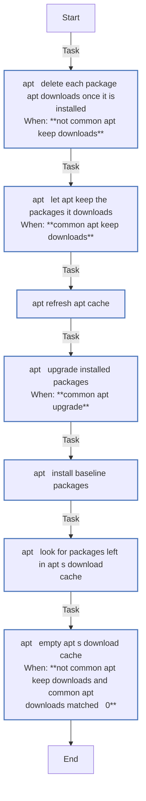

### `image.yml` - entry point `image`

| Task | Module | When |
|---|---|---|
| Move this role's files from their 1.x names | `ansible.builtin.include_tasks` |  |
| Configure apt, and bring the packages up to date | `ansible.builtin.include_tasks` |  |
| Set the timezone | `ansible.builtin.include_tasks` |  |
| Create the user | `ansible.builtin.include_tasks` |  |
| Harden sshd, or take the hardening away | `ansible.builtin.include_tasks` |  |
| Put ~/.local/bin on PATH for all users | `ansible.builtin.include_tasks` |  |
| Write the tmux settings | `ansible.builtin.include_tasks` |  |
| Enable and start services | `ansible.builtin.include_tasks` | <code>ansible_facts['service_mgr'] == 'systemd'</code> |

```mermaid
flowchart TD
Start
classDef block stroke:#3498db,stroke-width:2px;
classDef task stroke:#4b76bb,stroke-width:2px;
classDef includeTasks stroke:#16a085,stroke-width:2px;
classDef importTasks stroke:#34495e,stroke-width:2px;
classDef includeRole stroke:#2980b9,stroke-width:2px;
classDef importRole stroke:#699ba7,stroke-width:2px;
classDef includeVars stroke:#8e44ad,stroke-width:2px;
classDef rescue stroke:#665352,stroke-width:2px;

  Start-->|Include task| image___Move_this_role_s_files_from_their_1_x_names_names_yml_0[image   move this role s files from their 1 x<br>names<br>include_task: names yml]:::includeTasks
  image___Move_this_role_s_files_from_their_1_x_names_names_yml_0-->|Include task| image___Configure_apt__and_bring_the_packages_up_to_date_apt_yml_1[image   configure apt  and bring the packages up<br>to date<br>include_task: apt yml]:::includeTasks
  image___Configure_apt__and_bring_the_packages_up_to_date_apt_yml_1-->|Include task| image___Set_the_timezone_timezone_yml_2[image   set the timezone<br>include_task: timezone yml]:::includeTasks
  image___Set_the_timezone_timezone_yml_2-->|Include task| image___Create_the_user_user_yml_3[image   create the user<br>include_task: user yml]:::includeTasks
  image___Create_the_user_user_yml_3-->|Include task| image___Harden_sshd__or_take_the_hardening_away_sshd_yml_4[image   harden sshd  or take the hardening away<br>include_task: sshd yml]:::includeTasks
  image___Harden_sshd__or_take_the_hardening_away_sshd_yml_4-->|Include task| image___Put____local_bin_on_PATH_for_all_users_profile_yml_5[image   put    local bin on path for all users<br>include_task: profile yml]:::includeTasks
  image___Put____local_bin_on_PATH_for_all_users_profile_yml_5-->|Include task| image___Write_the_tmux_settings_tmux_yml_6[image   write the tmux settings<br>include_task: tmux yml]:::includeTasks
  image___Write_the_tmux_settings_tmux_yml_6-->|Include task| image___Enable_and_start_services_services_yml_7[image   enable and start services<br>When: **ansible facts  service mgr       systemd**<br>include_task: services yml]:::includeTasks
  image___Enable_and_start_services_services_yml_7-->End
```

### `image_options.yml` - entry point `image_options`

| Task | Module | When |
|---|---|---|
| Record what the image is built with | `ansible.builtin.set_fact` |  |

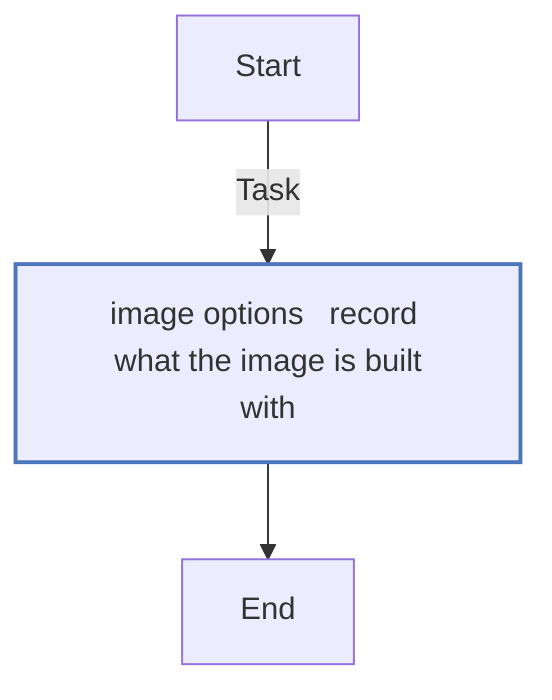

### `masked_units.yml`

| Task | Module | When |
|---|---|---|
| List which of the units to mask the VM has | `ansible.builtin.command` |  |
| Look for installed snaps | `ansible.builtin.find` | <code>common_masked_units_listed.stdout is search('^snapd[.]', multiline=True)</code> |
| Stop and mask the units | block | <code>common_masked_units_doomed &#124; length > 0</code> |
| &emsp;Stop each unit, timers, sockets and paths first | `ansible.builtin.systemd_service` |  |
| &emsp;Mask each unit | `ansible.builtin.systemd_service` |  |
| &emsp;Read which of the units failed | `ansible.builtin.command` |  |
| &emsp;Clear the failed state a unit was left in | `ansible.builtin.command` | <code>common_masked_units_failed &#124; length > 0</code> |

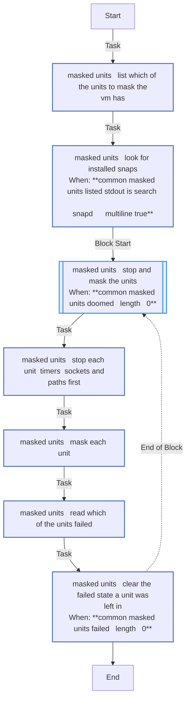

### `names.yml`

| Task | Module | When |
|---|---|---|
| Move each file to its name from 2.0 | `ansible.builtin.command` |  |

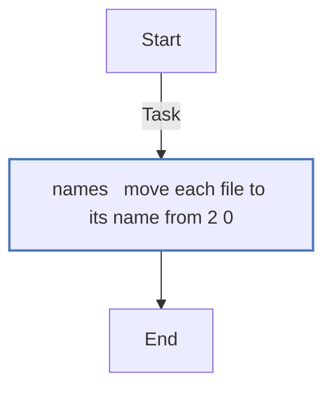

### `profile.yml`

| Task | Module | When |
|---|---|---|
| Put ~/.local/bin on PATH for all users | `ansible.builtin.template` |  |

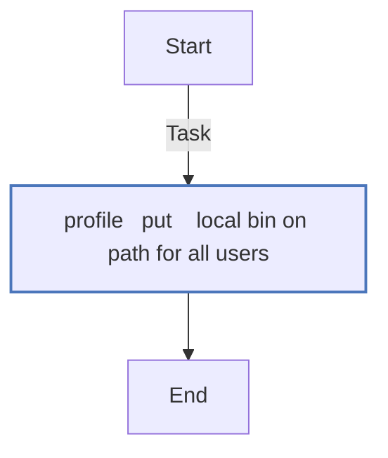

### `services.yml`

| Task | Module | When |
|---|---|---|
| Look for the guest agent's port | `ansible.builtin.stat` |  |
| Enable and start services | `ansible.builtin.service` |  |

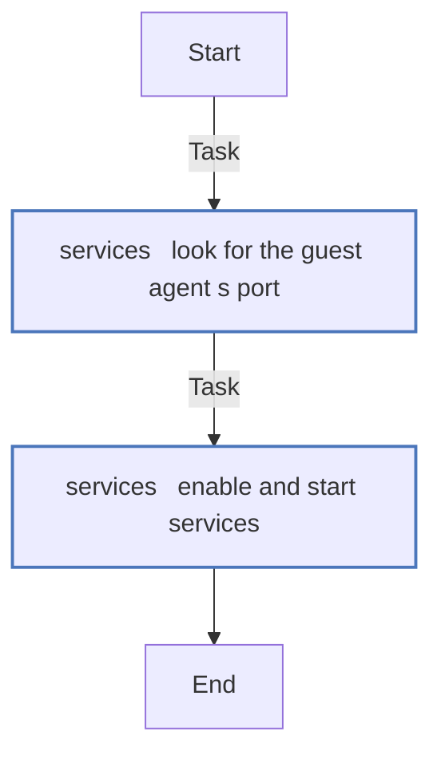

### `ssh_path.yml`

| Task | Module | When |
|---|---|---|
| Put the directories on PATH for ssh commands, and check what sshd gives | block | <code>common_ssh_path_dirs &#124; length > 0</code> |
| &emsp;Look up the home directory of {{ common_user }} | `ansible.builtin.getent` |  |
| &emsp;Read the PATH /etc/environment sets | `ansible.builtin.slurp` |  |
| &emsp;Fail when that PATH cannot be written into sshd's configuration | `ansible.builtin.assert` |  |
| &emsp;Put the same directories on PATH for ssh commands | `ansible.builtin.template` |  |
| &emsp;Find where the connections come from, for {{ common_user }} | `ansible.builtin.command` |  |
| &emsp;Read the PATH sshd gives the sessions of {{ common_user }} | `ansible.builtin.command` |  |
| &emsp;Find what else sets sshd's environment, if anything does | `ansible.builtin.find` |  |
| &emsp;Fail when sshd does not give that PATH to the sessions of {{ common_user }} | `ansible.builtin.assert` | <code>not ansible_check_mode</code> |
| Remove the PATH for ssh commands | `ansible.builtin.file` | <code>common_ssh_path_dirs &#124; length == 0</code> |

```mermaid
flowchart TD
Start
classDef block stroke:#3498db,stroke-width:2px;
classDef task stroke:#4b76bb,stroke-width:2px;
classDef includeTasks stroke:#16a085,stroke-width:2px;
classDef importTasks stroke:#34495e,stroke-width:2px;
classDef includeRole stroke:#2980b9,stroke-width:2px;
classDef importRole stroke:#699ba7,stroke-width:2px;
classDef includeVars stroke:#8e44ad,stroke-width:2px;
classDef rescue stroke:#665352,stroke-width:2px;

  Start-->|Block Start| ssh_path___Put_the_directories_on_PATH_for_ssh_commands__and_check_what_sshd_gives0_block_start_0[[ssh path   put the directories on path for ssh<br>commands  and check what sshd gives<br>When: **common ssh path dirs   length   0**]]:::block
  ssh_path___Put_the_directories_on_PATH_for_ssh_commands__and_check_what_sshd_gives0_block_start_0-->|Task| ssh_path___Look_up_the_home_directory_of_common_user0[ssh path   look up the home directory of common<br>user]:::task
  ssh_path___Look_up_the_home_directory_of_common_user0-->|Task| ssh_path___Read_the_PATH__etc_environment_sets1[ssh path   read the path  etc environment sets]:::task
  ssh_path___Read_the_PATH__etc_environment_sets1-->|Task| ssh_path___Fail_when_that_PATH_cannot_be_written_into_sshd_s_configuration2[ssh path   fail when that path cannot be written<br>into sshd s configuration]:::task
  ssh_path___Fail_when_that_PATH_cannot_be_written_into_sshd_s_configuration2-->|Task| ssh_path___Put_the_same_directories_on_PATH_for_ssh_commands3[ssh path   put the same directories on path for<br>ssh commands]:::task
  ssh_path___Put_the_same_directories_on_PATH_for_ssh_commands3-->|Task| ssh_path___Find_where_the_connections_come_from__for_common_user4[ssh path   find where the connections come from <br>for common user]:::task
  ssh_path___Find_where_the_connections_come_from__for_common_user4-->|Task| ssh_path___Read_the_PATH_sshd_gives_the_sessions_of_common_user5[ssh path   read the path sshd gives the sessions<br>of common user]:::task
  ssh_path___Read_the_PATH_sshd_gives_the_sessions_of_common_user5-->|Task| ssh_path___Find_what_else_sets_sshd_s_environment__if_anything_does6[ssh path   find what else sets sshd s environment <br>if anything does]:::task
  ssh_path___Find_what_else_sets_sshd_s_environment__if_anything_does6-->|Task| ssh_path___Fail_when_sshd_does_not_give_that_PATH_to_the_sessions_of_common_user7[ssh path   fail when sshd does not give that path<br>to the sessions of common user<br>When: **not ansible check mode**]:::task
  ssh_path___Fail_when_sshd_does_not_give_that_PATH_to_the_sessions_of_common_user7-.->|End of Block| ssh_path___Put_the_directories_on_PATH_for_ssh_commands__and_check_what_sshd_gives0_block_start_0
  ssh_path___Fail_when_sshd_does_not_give_that_PATH_to_the_sessions_of_common_user7-->|Task| ssh_path___Remove_the_PATH_for_ssh_commands1[ssh path   remove the path for ssh commands<br>When: **common ssh path dirs   length    0**]:::task
  ssh_path___Remove_the_PATH_for_ssh_commands1-->End
```

### `sshd.yml`

| Task | Module | When |
|---|---|---|
| Ensure sshd privilege separation directory exists | `ansible.builtin.file` | <code>common_harden_ssh or common_ssh_path_dirs &#124; length > 0</code> |
| Harden sshd | `ansible.builtin.template` | <code>common_harden_ssh</code> |
| Remove sshd hardening | `ansible.builtin.file` | <code>not common_harden_ssh</code> |

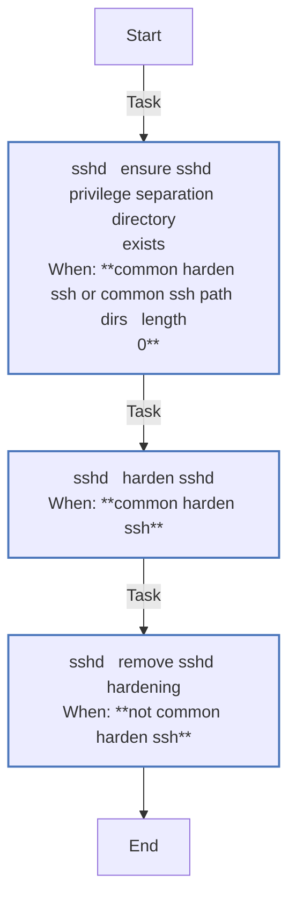

### `sudo.yml`

| Task | Module | When |
|---|---|---|
| Grant passwordless sudo | `ansible.builtin.template` | <code>common_user_passwordless_sudo</code> |
| Let a new cloud-init instance set the user up as Ubuntu does | `ansible.builtin.file` | <code>common_user_passwordless_sudo</code> |
| Take passwordless sudo away | block | <code>not common_user_passwordless_sudo</code> |
| &emsp;Refuse to take it away with no password to become root by | `ansible.builtin.assert` |  |
| &emsp;Hash the user's password | `ansible.builtin.command` |  |
| &emsp;Give the user the password sudo will ask for | `ansible.builtin.user` |  |
| &emsp;Read what sudo lets the user run now | `ansible.builtin.command` |  |
| &emsp;Refuse to take the rules away while no other takes the password | `ansible.builtin.assert` |  |
| &emsp;Revoke the role's passwordless sudo | `ansible.builtin.file` |  |
| &emsp;Take the user's rules out of cloud-init's sudoers file | `ansible.builtin.lineinfile` |  |
| &emsp;Look for cloud-init's settings folder | `ansible.builtin.stat` |  |
| &emsp;Keep a new cloud-init instance from giving the rule back | `ansible.builtin.copy` | <code>common_cloud_init_cfg_d.stat.isdir &#124; default(false)</code> |
| &emsp;Read the groups | `ansible.builtin.getent` |  |
| &emsp;Take the user out of the groups that reach root or the password | `ansible.builtin.command` | <code>common_user in (ansible_facts['getent_group'][common_user_group] &#124; default(['', '', ''], true))[2].split(',')</code> |
| &emsp;Read what sudo lets the user run in the end | `ansible.builtin.command` |  |
| &emsp;Fail on any rule that still runs without a password | `ansible.builtin.assert` | <code>not ansible_check_mode</code> |

```mermaid
flowchart TD
Start
classDef block stroke:#3498db,stroke-width:2px;
classDef task stroke:#4b76bb,stroke-width:2px;
classDef includeTasks stroke:#16a085,stroke-width:2px;
classDef importTasks stroke:#34495e,stroke-width:2px;
classDef includeRole stroke:#2980b9,stroke-width:2px;
classDef importRole stroke:#699ba7,stroke-width:2px;
classDef includeVars stroke:#8e44ad,stroke-width:2px;
classDef rescue stroke:#665352,stroke-width:2px;

  Start-->|Task| sudo___Grant_passwordless_sudo0[sudo   grant passwordless sudo<br>When: **common user passwordless sudo**]:::task
  sudo___Grant_passwordless_sudo0-->|Task| sudo___Let_a_new_cloud_init_instance_set_the_user_up_as_Ubuntu_does1[sudo   let a new cloud init instance set the user<br>up as ubuntu does<br>When: **common user passwordless sudo**]:::task
  sudo___Let_a_new_cloud_init_instance_set_the_user_up_as_Ubuntu_does1-->|Block Start| sudo___Take_passwordless_sudo_away2_block_start_0[[sudo   take passwordless sudo away<br>When: **not common user passwordless sudo**]]:::block
  sudo___Take_passwordless_sudo_away2_block_start_0-->|Task| sudo___Refuse_to_take_it_away_with_no_password_to_become_root_by0[sudo   refuse to take it away with no password to<br>become root by]:::task
  sudo___Refuse_to_take_it_away_with_no_password_to_become_root_by0-->|Task| sudo___Hash_the_user_s_password1[sudo   hash the user s password]:::task
  sudo___Hash_the_user_s_password1-->|Task| sudo___Give_the_user_the_password_sudo_will_ask_for2[sudo   give the user the password sudo will ask<br>for]:::task
  sudo___Give_the_user_the_password_sudo_will_ask_for2-->|Task| sudo___Read_what_sudo_lets_the_user_run_now3[sudo   read what sudo lets the user run now]:::task
  sudo___Read_what_sudo_lets_the_user_run_now3-->|Task| sudo___Refuse_to_take_the_rules_away_while_no_other_takes_the_password4[sudo   refuse to take the rules away while no<br>other takes the password]:::task
  sudo___Refuse_to_take_the_rules_away_while_no_other_takes_the_password4-->|Task| sudo___Revoke_the_role_s_passwordless_sudo5[sudo   revoke the role s passwordless sudo]:::task
  sudo___Revoke_the_role_s_passwordless_sudo5-->|Task| sudo___Take_the_user_s_rules_out_of_cloud_init_s_sudoers_file6[sudo   take the user s rules out of cloud init s<br>sudoers file]:::task
  sudo___Take_the_user_s_rules_out_of_cloud_init_s_sudoers_file6-->|Task| sudo___Look_for_cloud_init_s_settings_folder7[sudo   look for cloud init s settings folder]:::task
  sudo___Look_for_cloud_init_s_settings_folder7-->|Task| sudo___Keep_a_new_cloud_init_instance_from_giving_the_rule_back8[sudo   keep a new cloud init instance from giving<br>the rule back<br>When: **common cloud init cfg d stat isdir   default false<br>**]:::task
  sudo___Keep_a_new_cloud_init_instance_from_giving_the_rule_back8-->|Task| sudo___Read_the_groups9[sudo   read the groups]:::task
  sudo___Read_the_groups9-->|Task| sudo___Take_the_user_out_of_the_groups_that_reach_root_or_the_password10[sudo   take the user out of the groups that reach<br>root or the password<br>When: **common user in  ansible facts  getent group  <br>common user group    default               true  <br>2  split**]:::task
  sudo___Take_the_user_out_of_the_groups_that_reach_root_or_the_password10-->|Task| sudo___Read_what_sudo_lets_the_user_run_in_the_end11[sudo   read what sudo lets the user run in the end]:::task
  sudo___Read_what_sudo_lets_the_user_run_in_the_end11-->|Task| sudo___Fail_on_any_rule_that_still_runs_without_a_password12[sudo   fail on any rule that still runs without a<br>password<br>When: **not ansible check mode**]:::task
  sudo___Fail_on_any_rule_that_still_runs_without_a_password12-.->|End of Block| sudo___Take_passwordless_sudo_away2_block_start_0
  sudo___Fail_on_any_rule_that_still_runs_without_a_password12-->End
```

### `timezone.yml`

| Task | Module | When |
|---|---|---|
| Set timezone | `ansible.builtin.file` |  |
| Record timezone name | `ansible.builtin.copy` |  |

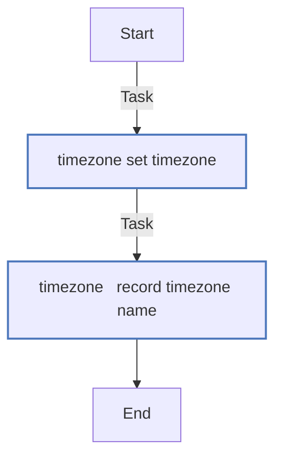

### `tmux.yml`

| Task | Module | When |
|---|---|---|
| Look for /etc/tmux.conf | `ansible.builtin.stat` |  |
| Take the settings' block by its 1.x marker out of /etc/tmux.conf | `ansible.builtin.blockinfile` | <code>common_tmux_conf.stat.exists</code> |
| Write the settings into /etc/tmux.conf | `ansible.builtin.blockinfile` | <code>common_tmux_settings &#124; length > 0</code> |
| Take the settings out of /etc/tmux.conf | `ansible.builtin.blockinfile` | <code>common_tmux_settings &#124; length == 0 and common_tmux_conf.stat.exists</code> |

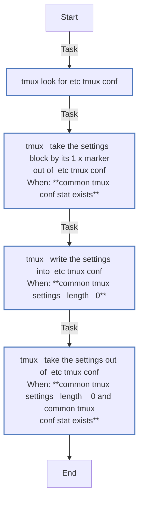

### `user.yml`

| Task | Module | When |
|---|---|---|
| Create user {{ common_user }} | `ansible.builtin.user` |  |

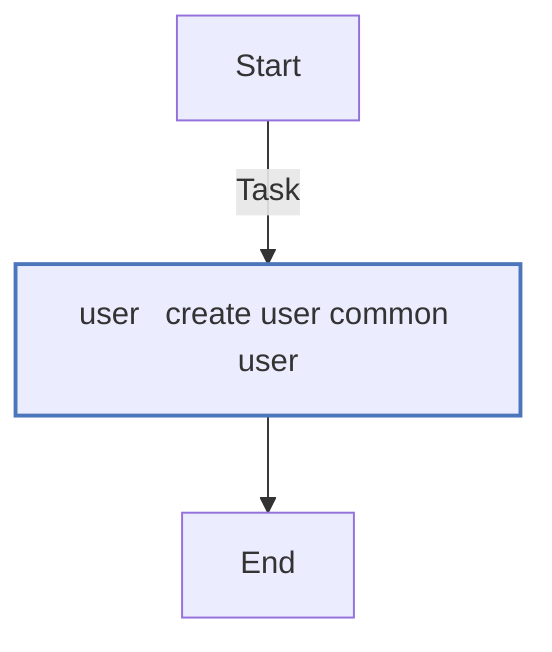

<!-- END_GENERATED: role -->
