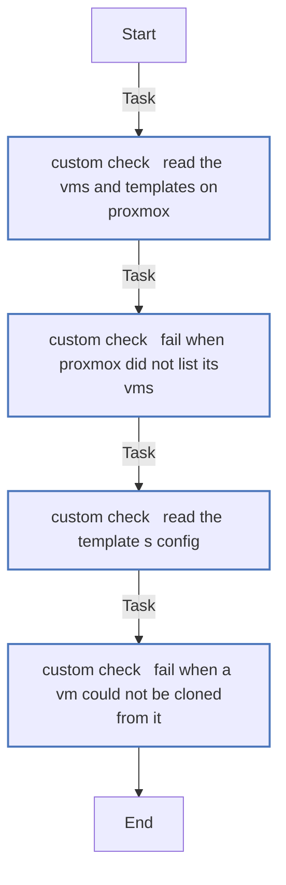
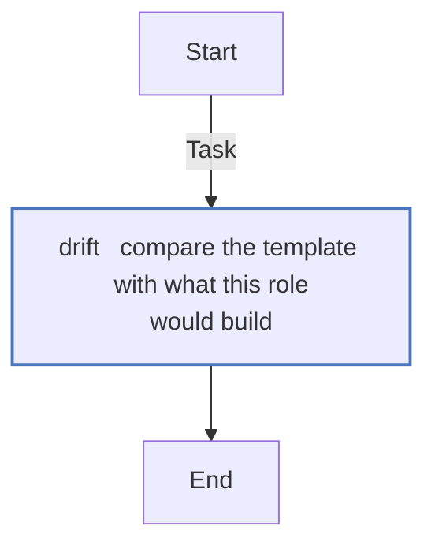
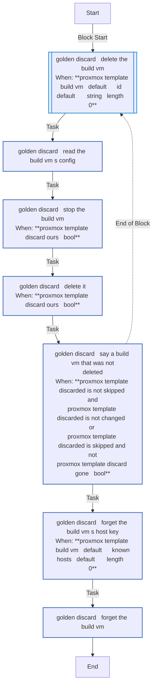
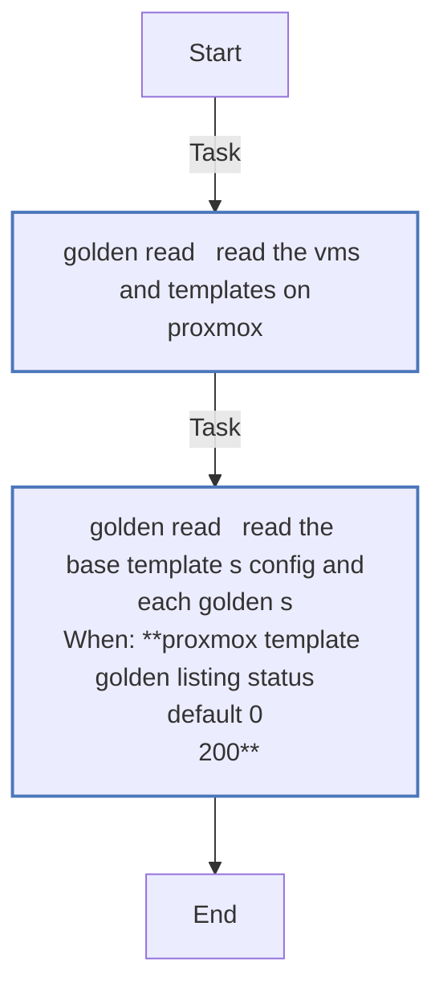
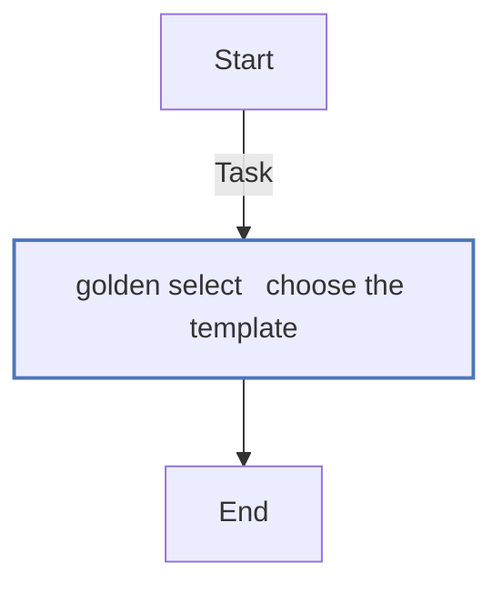

# `proxmox_template`

Builds the cloud-init Ubuntu template every VM is cloned from: downloads the cloud image, checks it against Ubuntu's `SHA256SUMS`, bakes the QEMU guest agent in, and imports it with `qm`. It runs on the Proxmox host over SSH as root, once - `just deploy --only template`, or `just deploy` when the template is missing.

What the host needs for it: [Requirements](../../getting-started/requirements.md). How it works: [§5.1](../../architecture/roles.md#51-proxmox_template--build-the-golden-image).

<!-- BEGIN_GENERATED: role -->
<!-- Generated by `just docs` from roles/proxmox_template/meta/argument_specs.yml, vars/main.yml and tasks/: edit that, not this section. -->

## Entry point `main`

**Build a cloud-init enabled VM template on a Proxmox VE host**

Runs on the PVE node over SSH. Downloads a cloud image, creates a VM with `qm`, imports the image as its root disk, adds a cloud-init drive and converts the VM to a template, recording in its notes what went into the disk. Skipped if the VMID already holds the finished template and it is what these settings would build; rebuilt at the same VMID when it differs (proxmox_template_rebuild); refused if the VMID holds anything else, on this node or another.

| Variable | Type | Default | Description |
|---|---|---|---|
| `proxmox_template_vmid` | int | `9000` | VMID the template is built under. Anything but the finished template there, on this node or another, fails the run. |
| `proxmox_template_name` | str | `ubuntu-24.04-cloudinit` | Template name. VMs are cloned from it by name, and a finished template at the VMID is recognised by it. |
| `proxmox_template_image_url` | str | `https://cloud-images.ubuntu.com/minimal/releases/noble/release/ubuntu-24.04-minimal-cloudimg-amd64.img` | Cloud image downloaded and imported as the template's root disk. |
| `proxmox_template_image_checksum` | str | `sha256:https://cloud-images.ubuntu.com/minimal/releases/noble/release/SHA256SUMS` | get_url checksum spec. Set to an empty string to skip verification. |
| `proxmox_template_image_dir` | path | `/var/lib/vz/agent-warehouse` | Directory on the node that keeps the pristine download. Created if missing. Keep it outside the content directories of a storage, or Proxmox lists the image in the UI (under template/iso it appeared as an ISO). |
| `proxmox_template_storage` | str | `local-lvm` | Proxmox storage the root disk and the cloud-init drive are created on. Set through `proxmox_storage` in local.yml. |
| `proxmox_template_bridge` | str | `vmbr0` | Bridge the template's net0 is attached to, and so every clone's. Set through `proxmox_bridge` in local.yml. |
| `proxmox_template_cores` | int | `2` | CPU cores of the template itself. proxmox_vm sets each VM's own. |
| `proxmox_template_memory_mb` | int | `2048` | Memory of the template itself, in MB. proxmox_vm sets each VM's own. |
| `proxmox_template_cpu_type` | str | `host` | CPU type (qm --cpu), which every VM cloned from the template keeps. |
| `proxmox_template_ostype` | str | `l26` | Guest OS type (qm --ostype). l26 is Linux 2.6 or later. |
| `proxmox_template_qm` | path | `/usr/sbin/qm` | Path of qm on the node. Tests point it at a stand-in. |
| `proxmox_template_install_guest_agent` | bool | `true` | Bake qemu-guest-agent into the image with virt-customize. Required for Proxmox to report a DHCP-assigned address. |
| `proxmox_template_customize_packages` | list of `str` | `[qemu-guest-agent]` | Packages installed into the image by virt-customize. |
| `proxmox_template_manage_libguestfs` | bool | `true` | Install libguestfs-tools on the node. Disable where it is already present or faked. |
| `proxmox_template_virt_customize` | path | `/usr/bin/virt-customize` | Path of virt-customize on the node. Tests point it at a stand-in. |
| `proxmox_template_virt_cat` | str | `/usr/bin/virt-cat` | Path of virt-cat on the Proxmox host, which reads a downloaded image's os-release before it is built. |
| `proxmox_template_rebuild` | bool | `true` | Rebuild the template at the same VMID when it differs from what these settings would build - its CPU type, OS type, bridge, storage, image, packages or this version's build. VMs are full clones, which do not depend on it. One that keeps no record of this project's build is refused, never rebuilt, as it may be someone's own. Off, it is kept as it is and the differences are said, for a template a linked clone still uses, which Proxmox will not remove, or one changed by hand on purpose. |

## Entry point `drift`

**Say how the template differs from what this role would build, changing nothing**

Compares the template's config, as the caller read it from Proxmox, with what this role would build - the qm settings every clone inherits and, from the record in its notes, the image, packages and build version - and records the differences in proxmox_template_drift, empty when there are none. Proxmox is asked nothing, and nothing is changed.

| Variable | Type | Default | Description |
|---|---|---|---|
| `proxmox_template_drift_config` | dict |  | **Required.** The template's config, as /nodes/&lt;node&gt;/qemu/&lt;vmid&gt;/config gives it. |

## Entry point `golden_read`

**Read the listing and the configs golden_select chooses from, once for the run - reading only**

| Variable | Type | Default | Description |
|---|---|---|---|
| `proxmox_template_custom` | str | `""` | A template you built, by its name, to clone in place of the one this role builds. Only read and cloned, never changed. |
| `proxmox_template_golden` | bool | `false` | Clone new VMs from a golden template of their key, with the toolchain installed already, so that configure, which still runs every task, finds most of its work done; where none is fresh, they clone the base and the deploy ends by building one. false clones the base template, as before. |
| `proxmox_template_golden_disk_size` | str | `12G` | The least a golden's disk is built at; a larger base keeps its own. A VM with a smaller disk than the golden's clones the base template. |
| `proxmox_template_golden_cores` | int | `2` | The cores of the VM a golden is built on. |
| `proxmox_template_golden_memory_mb` | int | `4096` | The memory, in MiB, of the VM a golden is built on. |
| `proxmox_template_known_hosts_dir` | path | computed | Where a build VM's host key is kept while it is built, under the checkout's .cache; never ~/.ssh. |

## Entry point `golden_collect`

**Delete build VMs left over and golden templates past twice the age a run selects one at**

| Variable | Type | Default | Description |
|---|---|---|---|
| `proxmox_template_custom` | str | `""` | A template you built, by its name, to clone in place of the one this role builds. Only read and cloned, never changed. |
| `proxmox_template_golden` | bool | `false` | Clone new VMs from a golden template of their key, with the toolchain installed already, so that configure, which still runs every task, finds most of its work done; where none is fresh, they clone the base and the deploy ends by building one. false clones the base template, as before. |
| `proxmox_template_golden_disk_size` | str | `12G` | The least a golden's disk is built at; a larger base keeps its own. A VM with a smaller disk than the golden's clones the base template. |
| `proxmox_template_golden_cores` | int | `2` | The cores of the VM a golden is built on. |
| `proxmox_template_golden_memory_mb` | int | `4096` | The memory, in MiB, of the VM a golden is built on. |
| `proxmox_template_known_hosts_dir` | path | computed | Where a build VM's host key is kept while it is built, under the checkout's .cache; never ~/.ssh. |
| `proxmox_template_golden_target` | dict |  | What this run would build, {key, base, disk, vms} (golden_targets); empty when nothing. |

## Entry point `custom_check`

**Hold a template you built to what a clone needs - reading only, on this machine**

| Variable | Type | Default | Description |
|---|---|---|---|
| `proxmox_template_custom` | str | `""` | A template you built, by its name, to clone in place of the one this role builds. Only read and cloned, never changed. |
| `proxmox_template_golden` | bool | `false` | Clone new VMs from a golden template of their key, with the toolchain installed already, so that configure, which still runs every task, finds most of its work done; where none is fresh, they clone the base and the deploy ends by building one. false clones the base template, as before. |
| `proxmox_template_golden_disk_size` | str | `12G` | The least a golden's disk is built at; a larger base keeps its own. A VM with a smaller disk than the golden's clones the base template. |
| `proxmox_template_golden_cores` | int | `2` | The cores of the VM a golden is built on. |
| `proxmox_template_golden_memory_mb` | int | `4096` | The memory, in MiB, of the VM a golden is built on. |
| `proxmox_template_known_hosts_dir` | path | computed | Where a build VM's host key is kept while it is built, under the checkout's .cache; never ~/.ssh. |

## Entry point `golden_select`

**Choose a new VM's template - a fresh golden of its key, else the base - reading only, on this machine**

| Variable | Type | Default | Description |
|---|---|---|---|
| `proxmox_template_custom` | str | `""` | A template you built, by its name, to clone in place of the one this role builds. Only read and cloned, never changed. |
| `proxmox_template_golden` | bool | `false` | Clone new VMs from a golden template of their key, with the toolchain installed already, so that configure, which still runs every task, finds most of its work done; where none is fresh, they clone the base and the deploy ends by building one. false clones the base template, as before. |
| `proxmox_template_golden_disk_size` | str | `12G` | The least a golden's disk is built at; a larger base keeps its own. A VM with a smaller disk than the golden's clones the base template. |
| `proxmox_template_golden_cores` | int | `2` | The cores of the VM a golden is built on. |
| `proxmox_template_golden_memory_mb` | int | `4096` | The memory, in MiB, of the VM a golden is built on. |
| `proxmox_template_known_hosts_dir` | path | computed | Where a build VM's host key is kept while it is built, under the checkout's .cache; never ~/.ssh. |
| `proxmox_template_golden_vm` | str |  | **Required.** The VM the template is chosen for. One that exists is never cloned, so it gets none. |
| `proxmox_template_golden_vm_disk` | str |  | **Required.** The VM's disk size. A golden built with a larger disk is no golden of it. |
| `proxmox_template_golden_digest` | str |  | **Required.** The toolchain digest every VM's options share, from the roles a golden carries (toolchain_digest). |
| `proxmox_template_golden_shared` | bool |  | **Required.** Whether the VM's image options are those a build sees. A VM that sets one of its own, as a host var, clones the base, since a golden built for it could not be shared. |

## Entry point `golden_build`

**Build the VM a golden template is made from - a full clone of the base, never ownership-tagged**

| Variable | Type | Default | Description |
|---|---|---|---|
| `proxmox_template_custom` | str | `""` | A template you built, by its name, to clone in place of the one this role builds. Only read and cloned, never changed. |
| `proxmox_template_golden` | bool | `false` | Clone new VMs from a golden template of their key, with the toolchain installed already, so that configure, which still runs every task, finds most of its work done; where none is fresh, they clone the base and the deploy ends by building one. false clones the base template, as before. |
| `proxmox_template_golden_disk_size` | str | `12G` | The least a golden's disk is built at; a larger base keeps its own. A VM with a smaller disk than the golden's clones the base template. |
| `proxmox_template_golden_cores` | int | `2` | The cores of the VM a golden is built on. |
| `proxmox_template_golden_memory_mb` | int | `4096` | The memory, in MiB, of the VM a golden is built on. |
| `proxmox_template_known_hosts_dir` | path | computed | Where a build VM's host key is kept while it is built, under the checkout's .cache; never ~/.ssh. |
| `proxmox_template_golden_target` | dict |  | **Required.** The key to build for, the base it is built from and the size of its disk, {key, base, disk, vms} (golden_targets). |

## Entry point `golden_template`

**Make the build VM a golden template - stripped, noted with its key, read back, converted**

| Variable | Type | Default | Description |
|---|---|---|---|
| `proxmox_template_custom` | str | `""` | A template you built, by its name, to clone in place of the one this role builds. Only read and cloned, never changed. |
| `proxmox_template_golden` | bool | `false` | Clone new VMs from a golden template of their key, with the toolchain installed already, so that configure, which still runs every task, finds most of its work done; where none is fresh, they clone the base and the deploy ends by building one. false clones the base template, as before. |
| `proxmox_template_golden_disk_size` | str | `12G` | The least a golden's disk is built at; a larger base keeps its own. A VM with a smaller disk than the golden's clones the base template. |
| `proxmox_template_golden_cores` | int | `2` | The cores of the VM a golden is built on. |
| `proxmox_template_golden_memory_mb` | int | `4096` | The memory, in MiB, of the VM a golden is built on. |
| `proxmox_template_known_hosts_dir` | path | computed | Where a build VM's host key is kept while it is built, under the checkout's .cache; never ~/.ssh. |
| `proxmox_template_build_vm` | dict |  | **Required.** The build VM, as golden_build recorded it. |

## Entry point `golden_discard`

**Delete the build VM a failed build left, under its own interlock, and its host key file**

| Variable | Type | Default | Description |
|---|---|---|---|
| `proxmox_template_custom` | str | `""` | A template you built, by its name, to clone in place of the one this role builds. Only read and cloned, never changed. |
| `proxmox_template_golden` | bool | `false` | Clone new VMs from a golden template of their key, with the toolchain installed already, so that configure, which still runs every task, finds most of its work done; where none is fresh, they clone the base and the deploy ends by building one. false clones the base template, as before. |
| `proxmox_template_golden_disk_size` | str | `12G` | The least a golden's disk is built at; a larger base keeps its own. A VM with a smaller disk than the golden's clones the base template. |
| `proxmox_template_golden_cores` | int | `2` | The cores of the VM a golden is built on. |
| `proxmox_template_golden_memory_mb` | int | `4096` | The memory, in MiB, of the VM a golden is built on. |
| `proxmox_template_known_hosts_dir` | path | computed | Where a build VM's host key is kept while it is built, under the checkout's .cache; never ~/.ssh. |
| `proxmox_template_build_vm` | dict |  | The build VM, as golden_build recorded it, or as much of it as was made. |

## Internal values

Set in `roles/proxmox_template/vars/main.yml`. These are not settings: Ansible ranks a role's vars above `local.yml`, so a value set there has no effect. 9 of the 25 are computed during a run, from earlier tasks' results. Each one's purpose is the first sentence of the comment above it, where it has one of its own.

| Name | Purpose | Value |
|---|---|---|
| `proxmox_template_build` | The build steps' own version. | `1` |
| `proxmox_template_image_url_default` | The default image and its checksum list, which is Ubuntu's own: any other URL needs a checksum given with it. | `https://cloud-images.ubuntu.com/minimal/releases/noble/release/ubuntu-24.04-minimal-cloudimg-amd64.img` |
| `proxmox_template_image_checksum_default` |  | `sha256:https://cloud-images.ubuntu.com/minimal/releases/noble/release/SHA256SUMS` |
| `proxmox_template_image_dir_default` | The image directory's default, and its name through 1.x, which the build moves it from, so the pristine download is not fetched again. | `/var/lib/vz/agent-warehouse` |
| `proxmox_template_image_dir_1x` |  | `/var/lib/vz/claude-on-proxmox` |
| `proxmox_template_scsihw` | The qm settings the role gives every template, which no setting changes. | `virtio-scsi-pci` |
| `proxmox_template_serial0` |  | `socket` |
| `proxmox_template_vga` |  | `serial0` |
| `proxmox_template_packages` | The packages put into the disk: none without the guest agent, which is what puts them there. | <code>{{ proxmox_template_customize_packages &#124; join(',') if proxmox_template_install_guest_agent &#124; bool else '' }}</code> |
| `proxmox_template_wanted` | What a template built now is, field by field, as proxmox_template_drift compares it. | `{"cpu": "{{ proxmox_template_cpu_type }}", "ostype": "{{ proxmox_template_ostype }}", "bridge": "{{ proxmox_template_bridge }}", "storage": "{{ proxmox_template_storage }}", "scsihw": "{{ proxmox_template_scsihw }}", "agent": "1", "serial0": "{{ proxmox_template_serial0 }}", "vga": "{{ proxmox_template_vga }}", "build": "{{ proxmox_template_build }}", "image": "{{ proxmox_template_image_url }}", "packages": "{{ proxmox_template_packages }}"}` |
| `proxmox_template_differences` | How the template at proxmox_template_vmid differs from that, read from `qm config` (tasks/main.yml's first task): nothing when there is no template there. | <code>{{ (proxmox_template_existing.stdout &#124; qm_config) &#124; proxmox_template_drift(proxmox_template_wanted) if proxmox_template_existing.rc &#124; default(1) == 0 else [] }}</code> |
| `proxmox_template_rebuilding` | Whether that template is rebuilt: it differs, and proxmox_template_rebuild leaves rebuilding on. | <code>{{ proxmox_template_differences &#124; length > 0 and proxmox_template_rebuild &#124; bool }}</code> |
| `proxmox_template_golden_build` | A golden template's internals. | `1` |
| `proxmox_template_golden_max_age` | How old a golden may be and still be cloned, and how old before it is deleted: twice that, so none a run of any checkout has just chosen is deleted under it. | `604800` |
| `proxmox_template_golden_collect_age` |  | `1209600` |
| `proxmox_template_build_fresh` | A build VM another run started less than this long ago is that run's: this run clones the base. | `1800` |
| `proxmox_template_build_agent_retries` | How long the build VM may take to report its address: tries, so many seconds apart. | `60` |
| `proxmox_template_build_agent_delay` |  | `5` |
| `proxmox_template_boot_disk` | The boot disk a golden's size is read from and set on, and a template you built is held to. | <code>{{ proxmox_vm_disk &#124; default('scsi0') }}</code> |
| `proxmox_template_golden_base_name` | The template a golden is built from: the user's, when they name one. | <code>{{ proxmox_template_custom &#124; default('', true) or proxmox_template_name }}</code> |
| `proxmox_template_golden_prefix` | The names and the tag a golden and a build VM carry. | <code>{{ claude_vm_tag &#124; lower }}-golden-</code> |
| `proxmox_template_build_prefix` |  | <code>{{ claude_vm_tag &#124; lower }}-build-</code> |
| `proxmox_template_build_tag` |  | <code>{{ claude_vm_tag &#124; lower }}-build</code> |
| `proxmox_template_golden_stripped` | The settings a golden must not carry, which a clone would inherit: a golden with a cloud-init user would make every clone look configured. | `["ciuser", "cipassword", "sshkeys", "nameserver", "searchdomain", "tags"]` |
| `proxmox_template_now` | Now, UTC, as the golden and build records keep it. | `{{ now(utc=true, fmt='%Y-%m-%dT%H:%M:%SZ') }}` |

## Tasks

Every task in `roles/proxmox_template/tasks/`, file by file, in the order the file lists them, with a flowchart of
each file. Generated from the task files, so a task added, renamed or removed shows here on the next `just docs`.

### `main.yml` - entry point `main`

| Task | Module | When |
|---|---|---|
| Check for existing VM {{ proxmox_template_vmid }} | `ansible.builtin.command` |  |
| Refuse to reuse VMID {{ proxmox_template_vmid }} | `ansible.builtin.assert` | <code>proxmox_template_existing.rc == 0</code> |
| Read the cluster-wide VM list | `ansible.builtin.slurp` | <code>proxmox_template_existing.rc != 0</code> |
| Refuse a VMID another node holds, {{ proxmox_template_vmid }} | `ansible.builtin.assert` | <code>proxmox_template_existing.rc != 0</code> |
| Refuse to rebuild a template this project has no record of building | `ansible.builtin.assert` | <code>proxmox_template_existing.rc == 0 and proxmox_template_rebuild &#124; bool</code> |
| Refuse a custom image without its checksum | `ansible.builtin.assert` |  |
| Say how the template differs from its settings | `ansible.builtin.debug` | <code>proxmox_template_differences &#124; length > 0</code> |
| Build the template | block | <code>proxmox_template_existing.rc != 0 or proxmox_template_rebuilding &#124; bool</code> |
| &emsp;Look for the image directory by its 1.x name | `ansible.builtin.stat` | <code>proxmox_template_image_dir == proxmox_template_image_dir_default</code> |
| &emsp;Look for the image directory by its name from 2.0 | `ansible.builtin.stat` | <code>proxmox_template_image_dir_1x_found.stat.isdir &#124; default(false)</code> |
| &emsp;Move the image directory to its name from 2.0 | `ansible.builtin.command` | <code>proxmox_template_image_dir_1x_found.stat.isdir &#124; default(false) and not (proxmox_template_image_dir_1x_found.stat.islnk &#124; default(false)) and not proxmox_template_image_dir_found.stat.exists and not ansible_check_mode</code> |
| &emsp;Ensure image directory exists | `ansible.builtin.file` |  |
| &emsp;Download cloud image | `ansible.builtin.get_url` |  |
| &emsp;Read the image's SHA-256 | `ansible.builtin.stat` |  |
| &emsp;Decide which image to import | `ansible.builtin.set_fact` |  |
| &emsp;Prepare the image for customization | block | <code>proxmox_template_install_guest_agent &#124; bool</code> |
| &emsp;&emsp;Install libguestfs-tools | `ansible.builtin.apt` | <code>proxmox_template_manage_libguestfs &#124; bool</code> |
| &emsp;&emsp;Copy the cloud image for customization | `ansible.builtin.copy` |  |
| &emsp;&emsp;Read which system the image holds | `ansible.builtin.command` |  |
| &emsp;&emsp;Refuse an image outside the Debian family | `ansible.builtin.assert` |  |
| &emsp;&emsp;Install packages into the image with virt-customize | `ansible.builtin.command` |  |
| &emsp;Remove the template that differs from its settings | `ansible.builtin.command` | <code>proxmox_template_existing.rc == 0</code> |
| &emsp;Fail when Proxmox kept the template | `ansible.builtin.assert` | <code>proxmox_template_existing.rc == 0</code> |
| &emsp;Create VM {{ proxmox_template_vmid }} | `ansible.builtin.command` |  |
| &emsp;Import the cloud image as the root disk | `ansible.builtin.command` |  |
| &emsp;Add cloud-init drive and set boot order | `ansible.builtin.command` |  |
| &emsp;Convert VM to template | `ansible.builtin.command` |  |
| &emsp;Read the template as it was built | `ansible.builtin.command` |  |
| &emsp;Fail when the template differs from its settings as built | `ansible.builtin.assert` |  |
| &emsp;*always:* | | |

```mermaid
flowchart TD
Start
classDef block stroke:#3498db,stroke-width:2px;
classDef task stroke:#4b76bb,stroke-width:2px;
classDef includeTasks stroke:#16a085,stroke-width:2px;
classDef importTasks stroke:#34495e,stroke-width:2px;
classDef includeRole stroke:#2980b9,stroke-width:2px;
classDef importRole stroke:#699ba7,stroke-width:2px;
classDef includeVars stroke:#8e44ad,stroke-width:2px;
classDef rescue stroke:#665352,stroke-width:2px;

  Start-->|Task| Check_for_existing_VM_proxmox_template_vmid0[check for existing vm proxmox template vmid]:::task
  Check_for_existing_VM_proxmox_template_vmid0-->|Task| Refuse_to_reuse_VMID_proxmox_template_vmid1[refuse to reuse vmid proxmox template vmid<br>When: **proxmox template existing rc    0**]:::task
  Refuse_to_reuse_VMID_proxmox_template_vmid1-->|Task| Read_the_cluster_wide_VM_list2[read the cluster wide vm list<br>When: **proxmox template existing rc    0**]:::task
  Read_the_cluster_wide_VM_list2-->|Task| Refuse_a_VMID_another_node_holds__proxmox_template_vmid3[refuse a vmid another node holds  proxmox template<br>vmid<br>When: **proxmox template existing rc    0**]:::task
  Refuse_a_VMID_another_node_holds__proxmox_template_vmid3-->|Task| Refuse_to_rebuild_a_template_this_project_has_no_record_of_building4[refuse to rebuild a template this project has no<br>record of building<br>When: **proxmox template existing rc    0 and proxmox<br>template rebuild   bool**]:::task
  Refuse_to_rebuild_a_template_this_project_has_no_record_of_building4-->|Task| Refuse_a_custom_image_without_its_checksum5[refuse a custom image without its checksum]:::task
  Refuse_a_custom_image_without_its_checksum5-->|Task| Say_how_the_template_differs_from_its_settings6[say how the template differs from its settings<br>When: **proxmox template differences   length   0**]:::task
  Say_how_the_template_differs_from_its_settings6-->|Block Start| Build_the_template7_block_start_0[[build the template<br>When: **proxmox template existing rc    0 or proxmox<br>template rebuilding   bool**]]:::block
  Build_the_template7_block_start_0-->|Task| Look_for_the_image_directory_by_its_1_x_name0[look for the image directory by its 1 x name<br>When: **proxmox template image dir    proxmox template<br>image dir default**]:::task
  Look_for_the_image_directory_by_its_1_x_name0-->|Task| Look_for_the_image_directory_by_its_name_from_2_01[look for the image directory by its name from 2 0<br>When: **proxmox template image dir 1x found stat isdir  <br>default false**]:::task
  Look_for_the_image_directory_by_its_name_from_2_01-->|Task| Move_the_image_directory_to_its_name_from_2_02[move the image directory to its name from 2 0<br>When: **proxmox template image dir 1x found stat isdir  <br>default false  and not  proxmox template image dir<br>1x found stat islnk   default false   and not<br>proxmox template image dir found stat exists and<br>not ansible check mode**]:::task
  Move_the_image_directory_to_its_name_from_2_02-->|Task| Ensure_image_directory_exists3[ensure image directory exists]:::task
  Ensure_image_directory_exists3-->|Task| Download_cloud_image4[download cloud image]:::task
  Download_cloud_image4-->|Task| Read_the_image_s_SHA_2565[read the image s sha 256]:::task
  Read_the_image_s_SHA_2565-->|Task| Decide_which_image_to_import6[decide which image to import]:::task
  Decide_which_image_to_import6-->|Block Start| Prepare_the_image_for_customization7_block_start_1[[prepare the image for customization<br>When: **proxmox template install guest agent   bool**]]:::block
  Prepare_the_image_for_customization7_block_start_1-->|Task| Install_libguestfs_tools0[install libguestfs tools<br>When: **proxmox template manage libguestfs   bool**]:::task
  Install_libguestfs_tools0-->|Task| Copy_the_cloud_image_for_customization1[copy the cloud image for customization]:::task
  Copy_the_cloud_image_for_customization1-->|Task| Read_which_system_the_image_holds2[read which system the image holds]:::task
  Read_which_system_the_image_holds2-->|Task| Refuse_an_image_outside_the_Debian_family3[refuse an image outside the debian family]:::task
  Refuse_an_image_outside_the_Debian_family3-->|Task| Install_packages_into_the_image_with_virt_customize4[install packages into the image with virt<br>customize]:::task
  Install_packages_into_the_image_with_virt_customize4-.->|End of Block| Prepare_the_image_for_customization7_block_start_1
  Install_packages_into_the_image_with_virt_customize4-->|Task| Remove_the_template_that_differs_from_its_settings8[remove the template that differs from its settings<br>When: **proxmox template existing rc    0**]:::task
  Remove_the_template_that_differs_from_its_settings8-->|Task| Fail_when_Proxmox_kept_the_template9[fail when proxmox kept the template<br>When: **proxmox template existing rc    0**]:::task
  Fail_when_Proxmox_kept_the_template9-->|Task| Create_VM_proxmox_template_vmid10[create vm proxmox template vmid]:::task
  Create_VM_proxmox_template_vmid10-->|Task| Import_the_cloud_image_as_the_root_disk11[import the cloud image as the root disk]:::task
  Import_the_cloud_image_as_the_root_disk11-->|Task| Add_cloud_init_drive_and_set_boot_order12[add cloud init drive and set boot order]:::task
  Add_cloud_init_drive_and_set_boot_order12-->|Task| Convert_VM_to_template13[convert vm to template]:::task
  Convert_VM_to_template13-->|Task| Read_the_template_as_it_was_built14[read the template as it was built]:::task
  Read_the_template_as_it_was_built14-->|Task| Fail_when_the_template_differs_from_its_settings_as_built15[fail when the template differs from its settings<br>as built]:::task
  Fail_when_the_template_differs_from_its_settings_as_built15-.->|End of Block| Build_the_template7_block_start_0
  Fail_when_the_template_differs_from_its_settings_as_built15-->End
```

| &emsp;&emsp;Remove the customised image | `ansible.builtin.file` | <code>proxmox_template_import_path is defined and proxmox_template_image.dest is defined and proxmox_template_import_path != proxmox_template_image.dest</code> |

### `custom_check.yml` - entry point `custom_check`

| Task | Module | When |
|---|---|---|
| Read the VMs and templates on Proxmox | `ansible.builtin.uri` |  |
| Fail when Proxmox did not list its VMs | `ansible.builtin.assert` |  |
| Read the template's config | `ansible.builtin.uri` |  |
| Fail when a VM could not be cloned from it | `ansible.builtin.assert` |  |

### `drift.yml` - entry point `drift`

| Task | Module | When |
|---|---|---|
| Compare the template with what this role would build | `ansible.builtin.set_fact` |  |

### `golden_build.yml` - entry point `golden_build`

| Task | Module | When |
|---|---|---|
| Build on the API | block |  |
| &emsp;Read how much memory the node has free | `ansible.builtin.uri` |  |
| &emsp;Fail when the node has no room for the build VM | `ansible.builtin.assert` | <code>proxmox_template_build_node.maxmem is defined and proxmox_template_build_node.mem is defined</code> |
| &emsp;Ask Proxmox for a free VMID | `ansible.builtin.uri` |  |
| &emsp;Record the build VM | `ansible.builtin.set_fact` |  |
| &emsp;Forget the host key of any earlier build of this key | `ansible.builtin.file` |  |
| &emsp;Clone the base template | `community.proxmox.proxmox_kvm` |  |
| &emsp;Fail when the clone made no new VM | `ansible.builtin.assert` |  |
| &emsp;Set up the build VM | `community.proxmox.proxmox_kvm` |  |
| &emsp;Size the build VM's disk | `community.proxmox.proxmox_disk` |  |
| &emsp;Start the build VM | `community.proxmox.proxmox_kvm` |  |
| &emsp;Read the build VM's NIC | `ansible.builtin.uri` |  |
| &emsp;Wait for the build VM's guest agent to report an address | `community.proxmox.proxmox_vm_info` |  |
| &emsp;Record where the build VM is | `ansible.builtin.set_fact` |  |

```mermaid
flowchart TD
Start
classDef block stroke:#3498db,stroke-width:2px;
classDef task stroke:#4b76bb,stroke-width:2px;
classDef includeTasks stroke:#16a085,stroke-width:2px;
classDef importTasks stroke:#34495e,stroke-width:2px;
classDef includeRole stroke:#2980b9,stroke-width:2px;
classDef importRole stroke:#699ba7,stroke-width:2px;
classDef includeVars stroke:#8e44ad,stroke-width:2px;
classDef rescue stroke:#665352,stroke-width:2px;

  Start-->|Block Start| golden_build___Build_on_the_API0_block_start_0[[golden build   build on the api]]:::block
  golden_build___Build_on_the_API0_block_start_0-->|Task| golden_build___Read_how_much_memory_the_node_has_free0[golden build   read how much memory the node has<br>free]:::task
  golden_build___Read_how_much_memory_the_node_has_free0-->|Task| golden_build___Fail_when_the_node_has_no_room_for_the_build_VM1[golden build   fail when the node has no room for<br>the build vm<br>When: **proxmox template build node maxmem is defined and<br>proxmox template build node mem is defined**]:::task
  golden_build___Fail_when_the_node_has_no_room_for_the_build_VM1-->|Task| golden_build___Ask_Proxmox_for_a_free_VMID2[golden build   ask proxmox for a free vmid]:::task
  golden_build___Ask_Proxmox_for_a_free_VMID2-->|Task| golden_build___Record_the_build_VM3[golden build   record the build vm]:::task
  golden_build___Record_the_build_VM3-->|Task| golden_build___Forget_the_host_key_of_any_earlier_build_of_this_key4[golden build   forget the host key of any earlier<br>build of this key]:::task
  golden_build___Forget_the_host_key_of_any_earlier_build_of_this_key4-->|Task| golden_build___Clone_the_base_template5[golden build   clone the base template]:::task
  golden_build___Clone_the_base_template5-->|Task| golden_build___Fail_when_the_clone_made_no_new_VM6[golden build   fail when the clone made no new vm]:::task
  golden_build___Fail_when_the_clone_made_no_new_VM6-->|Task| golden_build___Set_up_the_build_VM7[golden build   set up the build vm]:::task
  golden_build___Set_up_the_build_VM7-->|Task| golden_build___Size_the_build_VM_s_disk8[golden build   size the build vm s disk]:::task
  golden_build___Size_the_build_VM_s_disk8-->|Task| golden_build___Start_the_build_VM9[golden build   start the build vm]:::task
  golden_build___Start_the_build_VM9-->|Task| golden_build___Read_the_build_VM_s_NIC10[golden build   read the build vm s nic]:::task
  golden_build___Read_the_build_VM_s_NIC10-->|Task| golden_build___Wait_for_the_build_VM_s_guest_agent_to_report_an_address11[golden build   wait for the build vm s guest agent<br>to report an address]:::task
  golden_build___Wait_for_the_build_VM_s_guest_agent_to_report_an_address11-->|Task| golden_build___Record_where_the_build_VM_is12[golden build   record where the build vm is]:::task
  golden_build___Record_where_the_build_VM_is12-.->|End of Block| golden_build___Build_on_the_API0_block_start_0
  golden_build___Record_where_the_build_VM_is12-->End
```

### `golden_collect.yml` - entry point `golden_collect`

| Task | Module | When |
|---|---|---|
| Collect on the API | block |  |
| &emsp;Read the VMs and templates on Proxmox | `ansible.builtin.uri` |  |
| &emsp;Read each golden's record | `ansible.builtin.uri` |  |
| &emsp;Read each build VM's notes | `ansible.builtin.uri` |  |
| &emsp;Stop each build VM a run cut short left | `community.proxmox.proxmox_kvm` |  |
| &emsp;Delete each build VM a run cut short left | `community.proxmox.proxmox_kvm` |  |
| &emsp;Say each build VM Proxmox would not delete | `ansible.builtin.debug` |  |
| &emsp;Delete each golden past its age | `community.proxmox.proxmox_kvm` |  |
| &emsp;Say each golden Proxmox kept | `ansible.builtin.debug` |  |
| &emsp;Record whether another run is building this key | `ansible.builtin.set_fact` |  |

```mermaid
flowchart TD
Start
classDef block stroke:#3498db,stroke-width:2px;
classDef task stroke:#4b76bb,stroke-width:2px;
classDef includeTasks stroke:#16a085,stroke-width:2px;
classDef importTasks stroke:#34495e,stroke-width:2px;
classDef includeRole stroke:#2980b9,stroke-width:2px;
classDef importRole stroke:#699ba7,stroke-width:2px;
classDef includeVars stroke:#8e44ad,stroke-width:2px;
classDef rescue stroke:#665352,stroke-width:2px;

  Start-->|Block Start| golden_collect___Collect_on_the_API0_block_start_0[[golden collect   collect on the api]]:::block
  golden_collect___Collect_on_the_API0_block_start_0-->|Task| golden_collect___Read_the_VMs_and_templates_on_Proxmox0[golden collect   read the vms and templates on<br>proxmox]:::task
  golden_collect___Read_the_VMs_and_templates_on_Proxmox0-->|Task| golden_collect___Read_each_golden_s_record1[golden collect   read each golden s record]:::task
  golden_collect___Read_each_golden_s_record1-->|Task| golden_collect___Read_each_build_VM_s_notes2[golden collect   read each build vm s notes]:::task
  golden_collect___Read_each_build_VM_s_notes2-->|Task| golden_collect___Stop_each_build_VM_a_run_cut_short_left3[golden collect   stop each build vm a run cut<br>short left]:::task
  golden_collect___Stop_each_build_VM_a_run_cut_short_left3-->|Task| golden_collect___Delete_each_build_VM_a_run_cut_short_left4[golden collect   delete each build vm a run cut<br>short left]:::task
  golden_collect___Delete_each_build_VM_a_run_cut_short_left4-->|Task| golden_collect___Say_each_build_VM_Proxmox_would_not_delete5[golden collect   say each build vm proxmox would<br>not delete]:::task
  golden_collect___Say_each_build_VM_Proxmox_would_not_delete5-->|Task| golden_collect___Delete_each_golden_past_its_age6[golden collect   delete each golden past its age]:::task
  golden_collect___Delete_each_golden_past_its_age6-->|Task| golden_collect___Say_each_golden_Proxmox_kept7[golden collect   say each golden proxmox kept]:::task
  golden_collect___Say_each_golden_Proxmox_kept7-->|Task| golden_collect___Record_whether_another_run_is_building_this_key8[golden collect   record whether another run is<br>building this key]:::task
  golden_collect___Record_whether_another_run_is_building_this_key8-.->|End of Block| golden_collect___Collect_on_the_API0_block_start_0
  golden_collect___Record_whether_another_run_is_building_this_key8-->End
```

### `golden_discard.yml` - entry point `golden_discard`

| Task | Module | When |
|---|---|---|
| Delete the build VM | block | <code>(proxmox_template_build_vm &#124; default({})).id &#124; default('') &#124; string &#124; length > 0</code> |
| &emsp;Read the build VM's config | `ansible.builtin.uri` |  |
| &emsp;Stop the build VM | `community.proxmox.proxmox_kvm` | <code>proxmox_template_discard_ours &#124; bool</code> |
| &emsp;Delete it | `community.proxmox.proxmox_kvm` | <code>proxmox_template_discard_ours &#124; bool</code> |
| &emsp;Say a build VM that was not deleted | `ansible.builtin.debug` | <code>(proxmox_template_discarded is not skipped and proxmox_template_discarded is not changed) or (proxmox_template_discarded is skipped and not proxmox_template_discard_gone &#124; bool)</code> |
| Forget the build VM's host key | `ansible.builtin.file` | <code>(proxmox_template_build_vm &#124; default({})).known_hosts &#124; default('') &#124; length > 0</code> |
| Forget the build VM | `ansible.builtin.set_fact` |  |

### `golden_read.yml` - entry point `golden_read`

| Task | Module | When |
|---|---|---|
| Read the VMs and templates on Proxmox | `ansible.builtin.uri` |  |
| Read the base template's config and each golden's | `ansible.builtin.uri` | <code>proxmox_template_golden_listing.status &#124; default(0) == 200</code> |

### `golden_select.yml` - entry point `golden_select`

| Task | Module | When |
|---|---|---|
| Choose the template | `ansible.builtin.set_fact` |  |

### `golden_template.yml` - entry point `golden_template`

| Task | Module | When |
|---|---|---|
| Make the golden on the API | block |  |
| &emsp;Shut the build VM down | `community.proxmox.proxmox_kvm` |  |
| &emsp;Read what the build VM's config holds | `ansible.builtin.uri` |  |
| &emsp;Delete what a clone would inherit | `community.proxmox.proxmox_kvm` | <code>proxmox_template_golden_stripped &#124; select('in', proxmox_template_golden_before.json.data) &#124; list &#124; length > 0</code> |
| &emsp;Name and note it as a golden of its key | `community.proxmox.proxmox_kvm` |  |
| &emsp;Read it back as a clone would | `ansible.builtin.uri` |  |
| &emsp;Fail when it would hand a clone a setting of its own | `ansible.builtin.assert` |  |
| &emsp;Make it a template | `community.proxmox.proxmox_kvm` |  |
| &emsp;Forget the build VM's host key | `ansible.builtin.file` |  |

```mermaid
flowchart TD
Start
classDef block stroke:#3498db,stroke-width:2px;
classDef task stroke:#4b76bb,stroke-width:2px;
classDef includeTasks stroke:#16a085,stroke-width:2px;
classDef importTasks stroke:#34495e,stroke-width:2px;
classDef includeRole stroke:#2980b9,stroke-width:2px;
classDef importRole stroke:#699ba7,stroke-width:2px;
classDef includeVars stroke:#8e44ad,stroke-width:2px;
classDef rescue stroke:#665352,stroke-width:2px;

  Start-->|Block Start| golden_template___Make_the_golden_on_the_API0_block_start_0[[golden template   make the golden on the api]]:::block
  golden_template___Make_the_golden_on_the_API0_block_start_0-->|Task| golden_template___Shut_the_build_VM_down0[golden template   shut the build vm down]:::task
  golden_template___Shut_the_build_VM_down0-->|Task| golden_template___Read_what_the_build_VM_s_config_holds1[golden template   read what the build vm s config<br>holds]:::task
  golden_template___Read_what_the_build_VM_s_config_holds1-->|Task| golden_template___Delete_what_a_clone_would_inherit2[golden template   delete what a clone would<br>inherit<br>When: **proxmox template golden stripped   select  in  <br>proxmox template golden before json data    list  <br>length   0**]:::task
  golden_template___Delete_what_a_clone_would_inherit2-->|Task| golden_template___Name_and_note_it_as_a_golden_of_its_key3[golden template   name and note it as a golden of<br>its key]:::task
  golden_template___Name_and_note_it_as_a_golden_of_its_key3-->|Task| golden_template___Read_it_back_as_a_clone_would4[golden template   read it back as a clone would]:::task
  golden_template___Read_it_back_as_a_clone_would4-->|Task| golden_template___Fail_when_it_would_hand_a_clone_a_setting_of_its_own5[golden template   fail when it would hand a clone<br>a setting of its own]:::task
  golden_template___Fail_when_it_would_hand_a_clone_a_setting_of_its_own5-->|Task| golden_template___Make_it_a_template6[golden template   make it a template]:::task
  golden_template___Make_it_a_template6-->|Task| golden_template___Forget_the_build_VM_s_host_key7[golden template   forget the build vm s host key]:::task
  golden_template___Forget_the_build_VM_s_host_key7-.->|End of Block| golden_template___Make_the_golden_on_the_API0_block_start_0
  golden_template___Forget_the_build_VM_s_host_key7-->End
```

<!-- END_GENERATED: role -->
