# `vscode_server`

Port forwarding on the VM for VS Code's server, an editor's port forwards and Claude's sign-in in the browser - an sshd drop-in, checked against what sshd will really apply to the editor's connection - keepalives, and a higher inotify limit for the editor's file watcher. `--tags vscode_server` runs it alone; `vscode_remote: false` removes it.

Using it: [VS Code](../../guides/vscode.md#what-the-vm-gets), [Zed](../../guides/zed.md#what-the-vm-gets). How it works: [§5.7](../../architecture/roles.md#57-vscode_server--what-an-editors-remote-server-needs-on-the-host).

<!-- BEGIN_GENERATED: role -->
<!-- Generated by `just docs` from roles/vscode_server/meta/argument_specs.yml, vars/main.yml and tasks/: edit that, not this section. -->

## Entry point `main`

**Make a VM ready for a remote editor over SSH, and for Claude's sign-in**

Writes an sshd drop-in that keeps port forwarding enabled - VS Code's server is reached through it, and an editor's port forwards and Claude's sign-in in the browser use it - and adds keepalives, asserts the values sshd actually runs with, and raises the inotify watch limit an editor's file watcher needs. Disabled, it removes both files.

It runs whichever editor just code opens - Claude's sign-in in the browser and Zed's port forwards use the same forwarding, and any editor's file watcher the same limit - and keeps VS Code's name through 1.x, the --tags name 1.0 promised.

| Variable | Type | Default | Description |
|---|---|---|---|
| `vscode_server_enabled` | bool | `true` | Write the sshd drop-in and the inotify limit, and check what sshd applies. false removes both files. Set through vscode_remote in local.yml. |
| `vscode_server_user` | str | `dev` | The user the editor connects as, whose connection the sshd check evaluates Match blocks for. Set through vm_user in local.yml. |
| `vscode_server_client_alive_interval` | int | `60` | Seconds of silence after which sshd checks that a connection is alive (ClientAliveInterval); the drop-in sets it for every SSH connection, the editor's included. |
| `vscode_server_client_alive_count_max` | int | `3` | Unanswered checks after which sshd drops the connection (ClientAliveCountMax), so a client that went to sleep is reaped after interval times count seconds. |
| `vscode_server_inotify_watches` | int | `524288` | fs.inotify.max_user_watches, raised for an editor's file watcher on a large workspace. |
| `vscode_server_container_virt_types` | list of `str` | `[docker, container, containerd, podman, lxc]` | Virtualisation types under which /proc/sys is read-only, so the sysctl file is written but not applied. |

## Tasks

Every task in `roles/vscode_server/tasks/`, file by file, in the order the file lists them, with a flowchart of
each file. Generated from the task files, so a task added, renamed or removed shows here on the next `just docs`.

### `main.yml` - entry point `main`

| Task | Module | When |
|---|---|---|
| Set up and check what a remote editor needs | block | <code>vscode_server_enabled &#124; bool</code> |
| &emsp;Look for the tools the server installer needs | `ansible.builtin.command` |  |
| &emsp;Fail when the host cannot run VS Code Server | `ansible.builtin.assert` |  |
| &emsp;Ensure sshd privilege separation directory exists | `ansible.builtin.file` |  |
| &emsp;Allow port forwarding over the editor's SSH connection | `ansible.builtin.template` |  |
| &emsp;Find where the editor's connection will come from | `ansible.builtin.command` |  |
| &emsp;Read the configuration sshd applies to the editor's connection | `ansible.builtin.command` |  |
| &emsp;Find what turns forwarding off, if anything does | `ansible.builtin.find` |  |
| &emsp;Fail when sshd does not allow port forwarding | `ansible.builtin.assert` |  |
| &emsp;Raise the inotify watch limit for the editor's file watcher | `ansible.posix.sysctl` |  |

```mermaid
flowchart TD
Start
classDef block stroke:#3498db,stroke-width:2px;
classDef task stroke:#4b76bb,stroke-width:2px;
classDef includeTasks stroke:#16a085,stroke-width:2px;
classDef importTasks stroke:#34495e,stroke-width:2px;
classDef includeRole stroke:#2980b9,stroke-width:2px;
classDef importRole stroke:#699ba7,stroke-width:2px;
classDef includeVars stroke:#8e44ad,stroke-width:2px;
classDef rescue stroke:#665352,stroke-width:2px;

  Start-->|Block Start| Set_up_and_check_what_a_remote_editor_needs0_block_start_0[[set up and check what a remote editor needs<br>When: **vscode server enabled   bool**]]:::block
  Set_up_and_check_what_a_remote_editor_needs0_block_start_0-->|Task| Look_for_the_tools_the_server_installer_needs0[look for the tools the server installer needs]:::task
  Look_for_the_tools_the_server_installer_needs0-->|Task| Fail_when_the_host_cannot_run_VS_Code_Server1[fail when the host cannot run vs code server]:::task
  Fail_when_the_host_cannot_run_VS_Code_Server1-->|Task| Ensure_sshd_privilege_separation_directory_exists2[ensure sshd privilege separation directory exists]:::task
  Ensure_sshd_privilege_separation_directory_exists2-->|Task| Allow_port_forwarding_over_the_editor_s_SSH_connection3[allow port forwarding over the editor s ssh<br>connection]:::task
  Allow_port_forwarding_over_the_editor_s_SSH_connection3-->|Task| Find_where_the_editor_s_connection_will_come_from4[find where the editor s connection will come from]:::task
  Find_where_the_editor_s_connection_will_come_from4-->|Task| Read_the_configuration_sshd_applies_to_the_editor_s_connection5[read the configuration sshd applies to the editor<br>s connection]:::task
  Read_the_configuration_sshd_applies_to_the_editor_s_connection5-->|Task| Find_what_turns_forwarding_off__if_anything_does6[find what turns forwarding off  if anything does]:::task
  Find_what_turns_forwarding_off__if_anything_does6-->|Task| Fail_when_sshd_does_not_allow_port_forwarding7[fail when sshd does not allow port forwarding]:::task
  Fail_when_sshd_does_not_allow_port_forwarding7-->|Task| Raise_the_inotify_watch_limit_for_the_editor_s_file_watcher8[raise the inotify watch limit for the editor s<br>file watcher]:::task
  Raise_the_inotify_watch_limit_for_the_editor_s_file_watcher8-.->|End of Block| Set_up_and_check_what_a_remote_editor_needs0_block_start_0
  Raise_the_inotify_watch_limit_for_the_editor_s_file_watcher8-->|Task| Remove_the_sshd_drop_in1[remove the sshd drop in<br>When: **not vscode server enabled   bool**]:::task
  Remove_the_sshd_drop_in1-->|Task| Remove_the_inotify_setting2[remove the inotify setting<br>When: **not vscode server enabled   bool**]:::task
  Remove_the_inotify_setting2-->End
```

| Remove the sshd drop-in | `ansible.builtin.file` | <code>not vscode_server_enabled &#124; bool</code> |
| Remove the inotify setting | `ansible.builtin.file` | <code>not vscode_server_enabled &#124; bool</code> |

<!-- END_GENERATED: role -->
