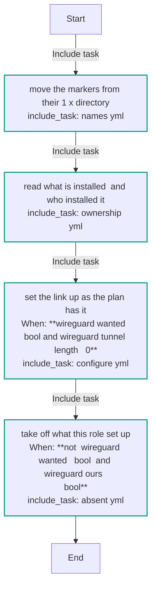
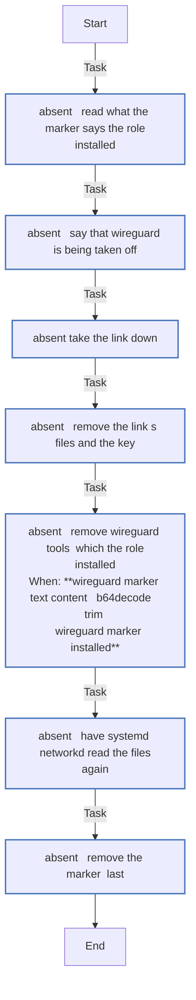
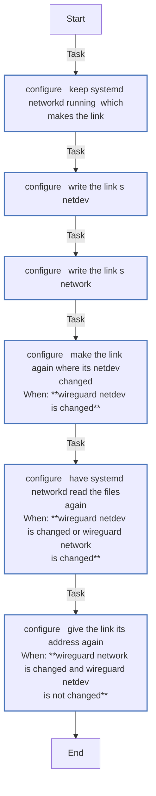
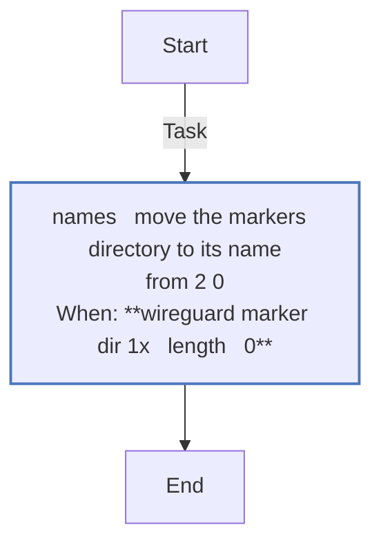
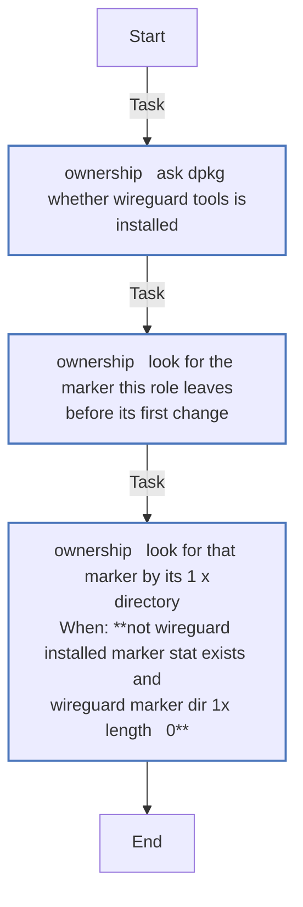
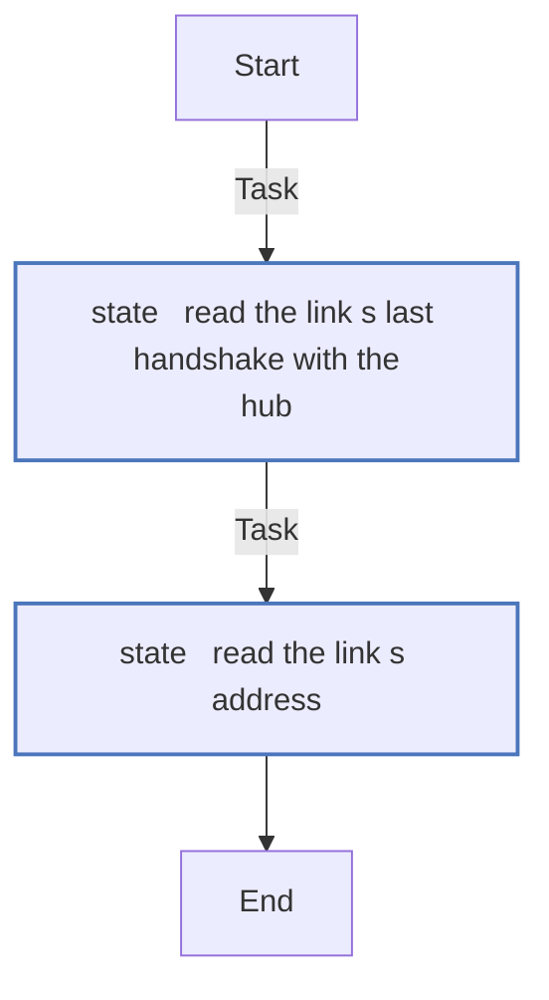
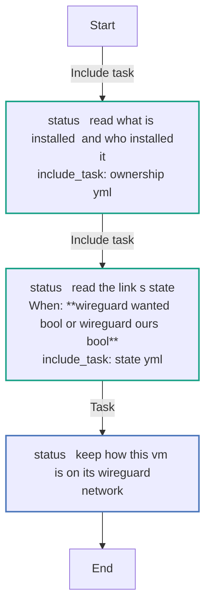

# `wireguard`

<!-- BEGIN_GENERATED: role -->
<!-- Generated by `just docs` from roles/wireguard/meta/argument_specs.yml, vars/main.yml and tasks/: edit that, not this section. -->

## Entry point `main`

**Set the VM's WireGuard link up as the members' plan has it, or take it off**

Writes systemd-networkd's netdev and network for the link claude-wg - the hub its one peer, the VM's address on the tunnel - from wireguard_tunnel, the members' plan for this VM, and makes the link again only when its netdev changed. With wireguard_wanted false it takes off what it set up, where its marker is, and wireguard-tools only where it installed it. A WireGuard of the user's own is left alone.

| Variable | Type | Default | Description |
|---|---|---|---|
| `wireguard_wanted` | bool | `false` | Whether WireGuard is the VPN; wired from the vpn setting. |
| `wireguard_tunnel` | dict | `{}` | The plan's tunnel for this VM - address, hub_public_key, endpoint, allowed_ips, keepalive - made and held to its rules by the core (lib/claude_vm/vpn/). Empty, nothing is set up. |
| `wireguard_off_why` | str | `wireguard_wanted is false` | The setting that turned WireGuard off, as the messages name it. |
| `wireguard_marker_dir` | path | `/var/lib/agent-warehouse` | Where the role's marker lives on the VM. |

## Entry point `key`

**Make the VM's WireGuard key on the VM, and read its public key**

Installs wireguard-tools, makes the VM's key pair once (root and systemd-network may read it, nobody else), and keeps its public key and whether the link has reached the hub in facts, for the members' plan. The private key never leaves the VM.

Also takes, as described under `main`: `wireguard_marker_dir`.

## Entry point `status`

**Say how the VM is on its WireGuard network, changing nothing**

Reads whose WireGuard is installed, the link's address and its last handshake with the hub, and keeps what just status shows in wireguard_status_found. Never makes a key, writes a file or changes the link.

Also takes, as described under `main`: `wireguard_wanted`, `wireguard_marker_dir`.

## Internal values

Set in `roles/wireguard/vars/main.yml`. These are not settings: Ansible ranks a role's vars above `local.yml`, so a value set there has no effect. 9 of the 18 are computed during a run, from earlier tasks' results. Each one's purpose is the first sentence of the comment above it, where it has one of its own.

| Name | Purpose | Value |
|---|---|---|
| `wireguard_installed_marker_path` | The names this role leaves on a VM, each its own, so a WireGuard of the user's (wg0, /etc/wireguard) is never touched. | `{{ wireguard_marker_dir }}/wireguard-installed` |
| `wireguard_marker_dir_default` | The markers' directory by its name through 1.x, which names.yml moves it from while wireguard_marker_dir is the default, and ownership.yml reads (2.x). | `/var/lib/agent-warehouse` |
| `wireguard_marker_dir_1x` |  | `{{ '/var/lib/claude-on-proxmox' if wireguard_marker_dir == wireguard_marker_dir_default else '' }}` |
| `wireguard_link` |  | `claude-wg` |
| `wireguard_key_path` |  | `/etc/systemd/network/claude-wg.key` |
| `wireguard_netdev_path` |  | `/etc/systemd/network/50-claude-wg.netdev` |
| `wireguard_network_path` |  | `/etc/systemd/network/50-claude-wg.network` |
| `wireguard_route_table` | The routing table the VM answers from its tunnel address through, and the rule's priority, ahead of the main table's. | `51920` |
| `wireguard_rule_priority` |  | `10000` |
| `wireguard_marker_installed` | What the marker says, written before the role's first change on a VM: whether the role installed wireguard-tools there, so off removes the package only then. | `installed wireguard-tools` |
| `wireguard_marker_found` |  | `found wireguard-tools` |
| `wireguard_package_present` | Whether wireguard-tools is installed, and the role's marker is there. | <code>{{ (wireguard_dpkg.stdout &#124; default('')) == 'installed' }}</code> |
| `wireguard_ours` |  | <code>{{ wireguard_installed_marker.stat.exists &#124; default(false) or wireguard_installed_marker_1x.stat.exists &#124; default(false) }}</code> |
| `wireguard_state_lines` | The link's last handshake with the hub, read on the VM (state.yml): its age in seconds, or -1 for none since the link was made. | <code>{{ (wireguard_state.stdout &#124; default('')).splitlines() }}</code> |
| `wireguard_now` |  | <code>{{ wireguard_state_lines[0] &#124; default(0) &#124; int }}</code> |
| `wireguard_handshake_at` |  | <code>{{ (wireguard_state_lines[1:] &#124; map('split') &#124; map('last') &#124; map('int') &#124; list &#124; max) if wireguard_state_lines &#124; length > 1 else 0 }}</code> |
| `wireguard_handshake_age` |  | <code>{{ (wireguard_now &#124; int - wireguard_handshake_at &#124; int) if wireguard_handshake_at &#124; int > 0 else -1 }}</code> |
| `wireguard_address_read` |  | <code>{{ (wireguard_address.stdout &#124; default('')).split() &#124; select('match', '^[0-9.]+/[0-9]+$') &#124; first &#124; default('') }}</code> |

## Tasks

Every task in `roles/wireguard/tasks/`, file by file, in the order the file lists them, with a flowchart of
each file. Generated from the task files, so a task added, renamed or removed shows here on the next `just docs`.

### `main.yml` - entry point `main`

| Task | Module | When |
|---|---|---|
| Move the markers from their 1.x directory | `ansible.builtin.include_tasks` |  |
| Read what is installed, and who installed it | `ansible.builtin.include_tasks` |  |
| Set the link up as the plan has it | `ansible.builtin.include_tasks` | <code>wireguard_wanted &#124; bool and wireguard_tunnel &#124; length > 0</code> |
| Take off what this role set up | `ansible.builtin.include_tasks` | <code>not (wireguard_wanted &#124; bool) and wireguard_ours &#124; bool</code> |

### `absent.yml`

| Task | Module | When |
|---|---|---|
| Read what the marker says the role installed | `ansible.builtin.slurp` |  |
| Say that WireGuard is being taken off | `ansible.builtin.debug` |  |
| Take the link down | `ansible.builtin.command` |  |
| Remove the link's files and the key | `ansible.builtin.file` |  |
| Remove wireguard-tools, which the role installed | `ansible.builtin.apt` | <code>(wireguard_marker_text.content &#124; b64decode &#124; trim) == wireguard_marker_installed</code> |
| Have systemd-networkd read the files again | `ansible.builtin.command` |  |
| Remove the marker, last | `ansible.builtin.file` |  |

### `configure.yml`

| Task | Module | When |
|---|---|---|
| Keep systemd-networkd running, which makes the link | `ansible.builtin.systemd_service` |  |
| Write the link's netdev | `ansible.builtin.copy` |  |
| Write the link's network | `ansible.builtin.copy` |  |
| Make the link again where its netdev changed | `ansible.builtin.command` | <code>wireguard_netdev is changed</code> |
| Have systemd-networkd read the files again | `ansible.builtin.command` | <code>wireguard_netdev is changed or wireguard_network is changed</code> |
| Give the link its address again | `ansible.builtin.command` | <code>wireguard_network is changed and wireguard_netdev is not changed</code> |

### `key.yml` - entry point `key`

| Task | Module | When |
|---|---|---|
| Move the markers from their 1.x directory | `ansible.builtin.include_tasks` |  |
| Read what is installed, and who installed it | `ansible.builtin.include_tasks` |  |
| Make the markers' directory | `ansible.builtin.file` |  |
| Leave the marker before the first change | `ansible.builtin.copy` | <code>not (wireguard_ours &#124; bool)</code> |
| Install wireguard-tools | `ansible.builtin.apt` | <code>not (wireguard_package_present &#124; bool)</code> |
| Make the VM's key, once | `ansible.builtin.command` |  |
| Keep the key readable by root and systemd-networkd alone | `ansible.builtin.file` | <code>not ansible_check_mode</code> |
| Read the VM's public key | `ansible.builtin.command` |  |
| Read the link's state | `ansible.builtin.include_tasks` |  |
| Keep the public key and whether the link has reached the hub | `ansible.builtin.set_fact` |  |

```mermaid
flowchart TD
Start
classDef block stroke:#3498db,stroke-width:2px;
classDef task stroke:#4b76bb,stroke-width:2px;
classDef includeTasks stroke:#16a085,stroke-width:2px;
classDef importTasks stroke:#34495e,stroke-width:2px;
classDef includeRole stroke:#2980b9,stroke-width:2px;
classDef importRole stroke:#699ba7,stroke-width:2px;
classDef includeVars stroke:#8e44ad,stroke-width:2px;
classDef rescue stroke:#665352,stroke-width:2px;

  Start-->|Include task| key___Move_the_markers_from_their_1_x_directory_names_yml_0[key   move the markers from their 1 x directory<br>include_task: names yml]:::includeTasks
  key___Move_the_markers_from_their_1_x_directory_names_yml_0-->|Include task| key___Read_what_is_installed__and_who_installed_it_ownership_yml_1[key   read what is installed  and who installed it<br>include_task: ownership yml]:::includeTasks
  key___Read_what_is_installed__and_who_installed_it_ownership_yml_1-->|Task| key___Make_the_markers__directory2[key   make the markers  directory]:::task
  key___Make_the_markers__directory2-->|Task| key___Leave_the_marker_before_the_first_change3[key   leave the marker before the first change<br>When: **not  wireguard ours   bool**]:::task
  key___Leave_the_marker_before_the_first_change3-->|Task| key___Install_wireguard_tools4[key   install wireguard tools<br>When: **not  wireguard package present   bool**]:::task
  key___Install_wireguard_tools4-->|Task| key___Make_the_VM_s_key__once5[key   make the vm s key  once]:::task
  key___Make_the_VM_s_key__once5-->|Task| key___Keep_the_key_readable_by_root_and_systemd_networkd_alone6[key   keep the key readable by root and systemd<br>networkd alone<br>When: **not ansible check mode**]:::task
  key___Keep_the_key_readable_by_root_and_systemd_networkd_alone6-->|Task| key___Read_the_VM_s_public_key7[key   read the vm s public key]:::task
  key___Read_the_VM_s_public_key7-->|Include task| key___Read_the_link_s_state_state_yml_8[key   read the link s state<br>include_task: state yml]:::includeTasks
  key___Read_the_link_s_state_state_yml_8-->|Task| key___Keep_the_public_key_and_whether_the_link_has_reached_the_hub9[key   keep the public key and whether the link has<br>reached the hub]:::task
  key___Keep_the_public_key_and_whether_the_link_has_reached_the_hub9-->End
```

### `names.yml`

| Task | Module | When |
|---|---|---|
| Move the markers' directory to its name from 2.0 | `ansible.builtin.command` | <code>wireguard_marker_dir_1x &#124; length > 0</code> |

### `ownership.yml`

| Task | Module | When |
|---|---|---|
| Ask dpkg whether wireguard-tools is installed | `ansible.builtin.command` |  |
| Look for the marker this role leaves before its first change | `ansible.builtin.stat` |  |
| Look for that marker by its 1.x directory | `ansible.builtin.stat` | <code>not wireguard_installed_marker.stat.exists and wireguard_marker_dir_1x &#124; length > 0</code> |

### `state.yml`

| Task | Module | When |
|---|---|---|
| Read the link's last handshake with the hub | `ansible.builtin.command` |  |
| Read the link's address | `ansible.builtin.command` |  |

### `status.yml` - entry point `status`

| Task | Module | When |
|---|---|---|
| Read what is installed, and who installed it | `ansible.builtin.include_tasks` |  |
| Read the link's state | `ansible.builtin.include_tasks` | <code>wireguard_wanted &#124; bool or wireguard_ours &#124; bool</code> |
| Keep how this VM is on its WireGuard network | `ansible.builtin.set_fact` |  |

<!-- END_GENERATED: role -->
